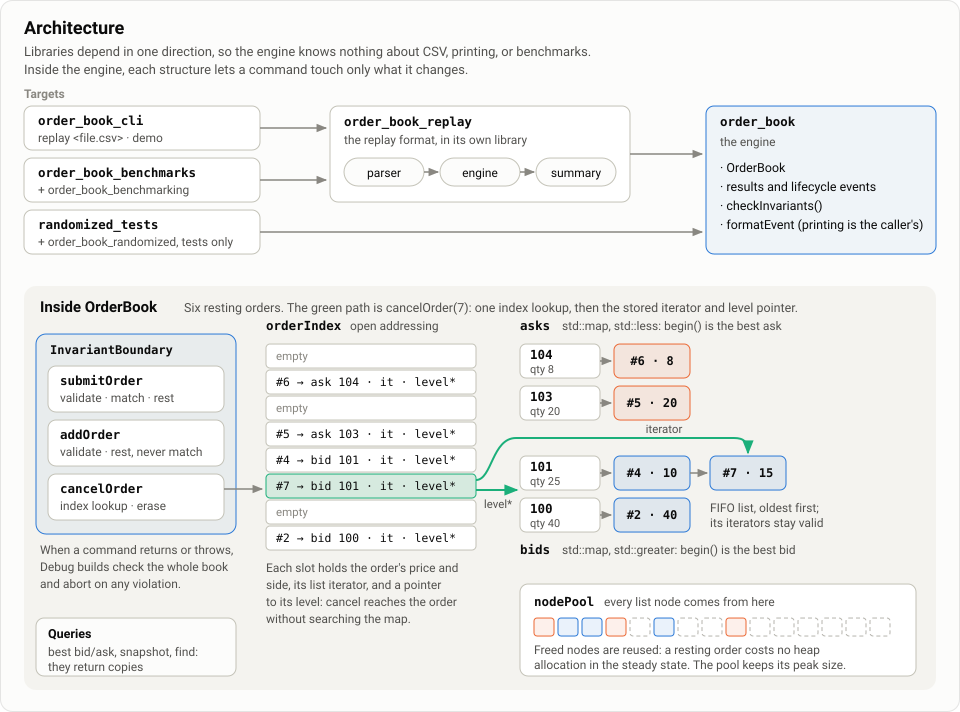
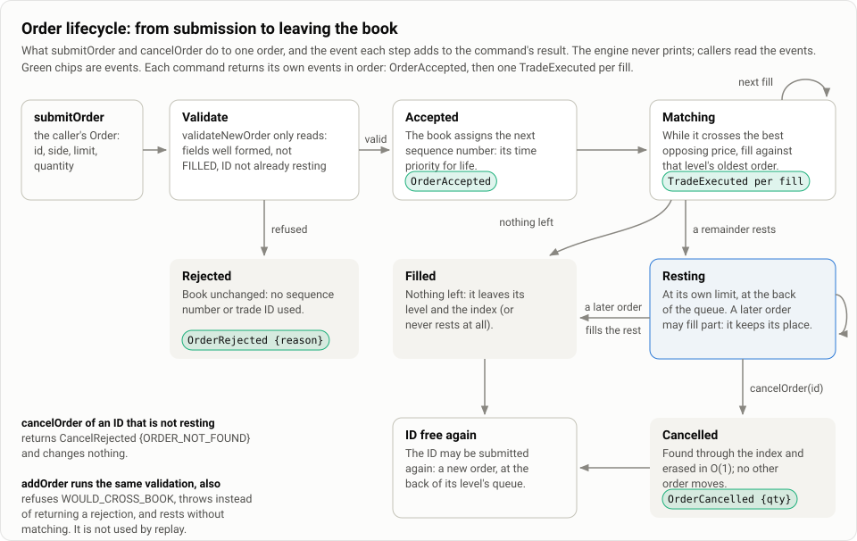
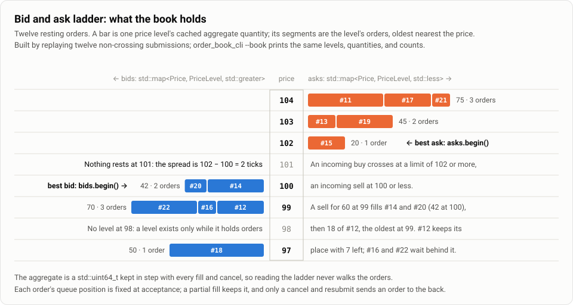
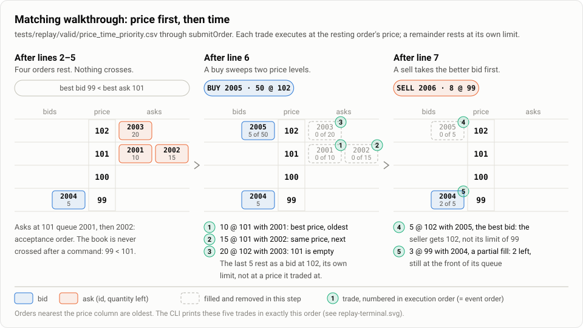
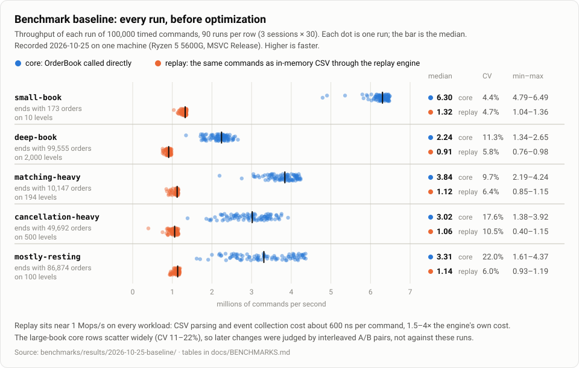

# Order Book

A correctness-first limit order book and matching engine in C++20. It matches limit orders by price-time priority and cancels orders in O(1). Every command returns the lifecycle events it produced. A whole-book invariant checker can run after every command. Around the engine are a CSV replay format and CLI, seeded randomized testing against an independent model, and a benchmark and profiling harness.

Version 1.0.0. One instrument, single-threaded, limit orders only (see [Limitations](#limitations)).

## Contents

- [Motivation](#motivation)
- [Quick start](#quick-start)
- [Architecture](#architecture)
- [Data structures](#data-structures)
- [Price-time priority](#price-time-priority)
- [Complexity](#complexity)
- [Public API](#public-api)
- [Building](#building)
- [Testing](#testing)
- [Replaying a session](#replaying-a-session)
- [Benchmarks and optimization](#benchmarks-and-optimization)
- [Limitations](#limitations)
- [Potential extensions](#potential-extensions)
- [Further documentation](#further-documentation)

## Motivation

A matching engine is small enough to read in an afternoon. It is also easy to get subtly wrong:

- a level's cached quantity drifts from its orders;
- an index entry outlives the order it points to;
- a partial fill loses its place in the queue;
- a failed allocation leaves half a trade behind.

None of these crash. They show up later as a wrong trade.

This project builds a limit order book with **correctness as the first requirement and performance as the second**, and applies the same discipline to both:

- **Every rule is written down where it is enforced.** The matching rules are in [`order_book.hpp`](include/order_book/order_book.hpp) and the invariants in [`invariants.hpp`](include/order_book/invariants.hpp). Each public type states what it guarantees on success, rejection, and failure.
- **Every rule is checked mechanically.**
  - `checkInvariants()` validates the whole book in one pass, and Debug builds run it after every command.
  - Each command's exact result and events are tested.
  - Long seeded command streams are compared, command by command, with an independent reference model.
  - Allocation failure is injected at every allocation.
- **Output is deterministic.** The same commands always give the same trades, events, and final book on every platform and compiler, so a session can be replayed from a file and compared byte for byte.
- **Performance work is measured.** A reproducible benchmark harness and a profiler located the costs. Each optimization was then a designed experiment, with a prediction, a paired measurement, and a review. Changes that did not pay for their complexity were reverted, and the report says so.

## Quick start

```bash
cmake -S . -B build/debug -G Ninja -DCMAKE_BUILD_TYPE=Debug
cmake --build build/debug
ctest --test-dir build/debug --output-on-failure
./build/debug/order_book_cli replay tests/replay/valid/price_time_priority.csv --trades --book
```

Using the library from your own CMake project (there are no install rules, so add the repository as a subdirectory):

```cmake
set(BUILD_TESTING OFF CACHE BOOL "" FORCE)  # optional: skip this repository's tests
add_subdirectory(path/to/order-book order-book)
target_link_libraries(your_target PRIVATE order_book)
```

```cpp
#include <iostream>

#include "order_book/event_format.hpp"
#include "order_book/order_book.hpp"

int main() {
    using namespace order_book;
    OrderBook book;

    // Order(id, price in ticks, quantity, sequence number, side). The book replaces the
    // sequence number with its own when it accepts the order.
    book.submitOrder(Order(1, 101, 10, 1, Side::SELL));  // rests: nothing to match
    book.submitOrder(Order(2, 101, 15, 1, Side::SELL));  // rests behind order 1

    // Buys 20 at up to 101: all 10 of order 1, then 10 of order 2's 15.
    const SubmissionResult result = book.submitOrder(Order(3, 101, 20, 1, Side::BUY));
    for(const BookEvent& event : result.getEvents()) {
        std::cout << formatEvent(event) << '\n';
    }

    const CancellationResult cancel = book.cancelOrder(2);  // the 5 left on order 2
    std::cout << formatEvent(cancel.getEvents()[0]) << '\n';
    std::cout << "resting orders: " << book.activeOrderCount() << '\n';
}
```

```text
OrderAccepted id=3 side=BUY price=101 qty=20
TradeExecuted incoming=3 resting=1 price=101 qty=10
TradeExecuted incoming=3 resting=2 price=101 qty=10
OrderCancelled id=2 qty=5
resting orders: 0
```

## Architecture

The code is split into libraries that depend in one direction only. The book knows nothing about CSV, printing, or benchmarks.



| Target | Kind | Role |
|---|---|---|
| `order_book` | static library | The engine: `OrderBook`, `Order`, the result and event types, the invariant checker, and `formatEvent`. |
| `order_book_replay` | static library | The CSV replay format: a parser that turns text into typed records, an engine that runs records through a book, and locale-free printing of the outcome. |
| `order_book_cli` | executable | `replay <file.csv>` and a scripted `demo`. Non-interactive, so it scripts cleanly. |
| `order_book_reference` | test library | `ReferenceBook`, an independent model of the book that never touches an `OrderBook`. |
| `order_book_randomized`, `randomized_tests` | test library, executable | Seeded command generation against the reference model, failure reports, and stream shrinking. |
| `order_book_benchmarking`, `order_book_benchmarks` | optional | Workload generation and timing (`ORDER_BOOK_BUILD_BENCHMARKS=ON`). |
| `sampling_profiler`, `allocation_profile` | optional | Profiling tools (`ORDER_BOOK_BUILD_PROFILING=ON`, which needs the benchmarks). |

### Life of a command



`submitOrder(order)`:

1. An `InvariantBoundary` guard is created. When the command returns or throws, it checks the whole book if automatic checks are on.
2. `validateNewOrder` reads, and changes nothing. It checks for malformed fields, an order already `FILLED`, and an ID already resting. A failure returns a `REJECTED` result, and nothing is consumed.
3. The book assigns its next sequence number and captures the `OrderAccepted` event.
4. `matchOrder` repeats `executeOnce` while the order has quantity left and crosses the best opposing price. Each step fills against the oldest order at the best opposing level and produces exactly one `Trade`. Each step validates and builds its trade before mutating, so a throw inside it changes nothing.
5. The `SubmissionResult` and its events are built.
6. Any remainder rests at its own limit price. Resting is the last step that can fail, so a remainder never rests behind a throw.

`cancelOrder(id)` looks the ID up in the index and builds its result first. It then erases the order through the stored list iterator and level pointer, and erases the level if it is now empty. It never allocates. An ID that is not resting returns a rejected result, not an exception.

### Repository layout

| Path | Contents |
|---|---|
| `include/order_book/` | Public and implementation headers (see [Public API](#public-api)) |
| `src/` | Library implementations |
| `apps/` | The CLI |
| `tests/` | One executable per test file, no framework. `tests/randomized/` is the randomized harness and its saved regressions. `tests/replay/` holds replay samples and the CLI's expected output. |
| `benchmarks/` | Benchmark harness, profiling tools, A/B comparison script, and recorded results |
| `docs/` | Format specification, benchmark baseline, profile, experiments, and optimization report |

## Data structures

```text
OrderBook
├── bids : std::map<Price, PriceLevel, std::greater>   begin() is the best (highest) bid
│     101 → PriceLevel { quantity = 25, orders: [#4 qty 10] ⇄ [#7 qty 15] }   oldest first
│     100 → PriceLevel { quantity = 40, orders: [#2 qty 40] }
├── asks : std::map<Price, PriceLevel, std::less>      begin() is the best (lowest) ask
│     103 → PriceLevel { ... }
├── orderIndex : OrderIndex   OrderId → { owner, OrderLocation { price, side, list iterator, PriceLevel* } }
├── buyStops, sellStops : std::map<Price, StopLevel>   pending stops, nearest trigger first
├── pendingIndex : OrderIndex  OrderId → StopLocation { stop price, side, list iterator, StopLevel* }
└── nodePool   : NodePool     the memory for every level's and stop level's list nodes, reused
```

| Structure | Implementation | Why |
|---|---|---|
| Price | `unsigned int` ticks, assuming a $0.01 tick | Exact comparison and no floating point. Zero is invalid for every price, quantity, ID, and sequence number. |
| `Order` | ID, price, side, type, initial and remaining quantity, sequence number, `FillStatus` | The sequence number is assigned by the book on acceptance and kept for life, so a partially filled order keeps its place. |
| `PriceLevel` | `std::list<Order>` in FIFO order, plus a cached aggregate `std::uint64_t` quantity | List iterators stay valid while other orders come and go, so the index can point straight at an order, and erasing from the middle is O(1). The aggregate is 64-bit so a level of many maximal orders cannot overflow it. |
| Sides | `std::map<Price, PriceLevel>`, descending for bids and ascending for asks | `begin()` is the best price on both sides. Map elements never move, so a pointer to a level stays valid until the level is erased, and levels are erased only once empty. |
| `OrderIndex` | Open-addressed hash table: linear probing, Fibonacci hashing, at most three quarters full, backward-shift deletion | O(1) expected lookup for duplicate checks and cancels. It replaced `std::unordered_map` after profiling showed per-entry heap nodes and cache misses ([experiment 8](docs/OPTIMIZATION-EXPERIMENTS.md#experiment-8-replace-the-order-indexs-container-kept)). |
| `OrderLocation` | Price, side, list iterator, and `PriceLevel*` | A cancel reaches the order and its level without searching the map. Each index slot also holds the order's self-trade-prevention owner, in what was padding, so a slot is still 32 bytes and `Order` is unchanged. |
| `NodePool` | Per-book free lists by size class, filled in chunks of 256 nodes, used by the level lists through `PoolAllocator` | A resting order costs no heap allocation in the steady state. A book keeps its peak node memory until it is destroyed. |
| `SmallVector<T, N>` | Inline storage for `N` elements, falling back to the heap beyond that | A command's result allocates nothing unless a submission makes more than four trades. |

The same structures seen as a trader would, as a price ladder:



`price_level.hpp`, `order_location.hpp`, `order_index.hpp`, `node_pool.hpp`, `small_vector.hpp`, and `result_recorder.hpp` are implementation detail. The book never hands one of them out (a result's trades and events come back as `SmallVector`s, which the API names only through `SubmissionTrades`, `SubmissionEvents`, and `CancellationEvents`), and they may change in any release.

## Price-time priority

The book matches **limit orders** by price, then time:

1. **Crossing.** An incoming buy crosses when its limit price is at or above the best ask. An incoming sell crosses when its limit is at or below the best bid.
2. **Price priority.** A crossing order always trades against the best opposing level first: the lowest ask, or the highest bid. It moves to the next level only once that level is empty.
3. **Time priority.** Within a level, orders fill strictly in the order the book accepted them. Acceptance order is the queue position, recorded by a sequence number the book assigns. A number supplied by the caller is ignored.
4. **Execution price.** Every trade executes at the **resting** order's price. An incoming order that crosses deeper than the best price gets the better price.
5. **Fill size.** Each match is for the smaller of the two remaining quantities. A partially filled resting order keeps its place at the front of its queue, and a fully filled one leaves the book.
6. **Remainder.** Matching stops when the incoming order is filled, or when it no longer crosses. Any remainder rests at the back of the queue at its **own limit price**, keeping the sequence number it was given on acceptance.
7. **Cancellation.** A cancel removes the order and leaves every other order's position unchanged. Resubmitting the same ID later puts it at the back of the queue.
8. **Never crossed.** After every public command, the best bid is strictly below the best ask. `submitOrder` guarantees this by matching. `addOrder` rests without matching, so it refuses an order that would cross (`WOULD_CROSS_BOOK`).

### Order behaviors

An `OrderRequest` says how its order may trade. These rules add to the ones above, which every behavior keeps (they are being built toward v2.0.0, one at a time):

- **Expiry** ([ADR 0002](docs/adr/0002-unfilled-remainders-expire.md)). A well-formed request is always accepted, whatever the book holds. Whatever it may not trade or rest **expires**: an `OrderExpired` for the whole remainder ends its events, and the remainder still counts as the result's remaining quantity, so traded plus remaining equals accepted. For a `submitOrder(OrderRequest)` result, a remaining quantity above zero therefore does not mean the order rests; only the absence of a trailing `OrderExpired` says it did. An expiring order consumes a sequence number, and its ID is free again at once.
- **Immediate-or-cancel** (`timeInForce = IOC`). It trades while it crosses, up to its limit price, at each resting price, then its remainder expires. One that does not cross, or faces an empty side, is accepted and wholly expired. It never rests. Like a GTC submission, it is not atomic: if an allocation fails, executions already made stand.
- **Market orders** (`type = MARKET`, price 0, and `IOC` or `FOK`: a GTC market order is malformed, `TIME_IN_FORCE_NOT_ALLOWED`, and a price on one is `PRICE_NOT_ALLOWED`). It has **no price protection**: it trades at each resting price, as far through the opposite side as its quantity takes it, possibly the whole side, and its remainder expires. One facing an empty side is accepted and wholly expired. Its `OrderAccepted` reports price 0 (`price=MARKET` when printed). It is sized by quantity only.
- **Post-only** (`postOnly = true`, FIX `ExecInst=6`; only on a GTC `LIMIT` order, else `POST_ONLY_NOT_ALLOWED`). If it would take liquidity on arrival, meaning at or through the best opposing price (a locked price counts, an empty side never does), it is accepted and wholly expired, with no trades and nothing allocated; it is never repriced. Otherwise it rests as an ordinary limit order, and the flag is forgotten. Either way it is strongly atomic and numbered last, like `addOrder`: a failed allocation changes nothing. `addOrder` is unchanged: it is the setup and seeding command, which throws `WOULD_CROSS_BOOK` rather than reporting.
- **Self-trade prevention** (`owner`, an opaque `OwnerId` where 0 means none, and `selfTradePrevention`; FIX SelfMatchPreventionID and SelfMatchPreventionInstruction, with this book's own values). Just before each execution, if the incoming order has a nonzero owner and the order it would trade with next has the same owner, the **incoming** order's mode decides: `CANCEL_RESTING` (the default) removes the resting order whole and goes on matching; `CANCEL_INCOMING` leaves it and stops, expiring the incoming remainder even on a GTC order; `CANCEL_BOTH` removes it and expires the remainder. Each is reported as a `SelfTradePrevented` among the trades, in execution order. A prevention is never a trade: it consumes no trade ID. Trades made before it stand. The owner is kept with a resting order (and appears in no event or query); its mode is not. A mode that is not an enumerator is malformed whatever the owner. Post-only never matches, so it never runs this.
- **Stop and stop-limit orders** (`type = STOP`, price 0 and `IOC` or `FOK`, or `STOP_LIMIT`, with a limit price and any time in force; both need a `stopPrice`, which no other type may carry, and neither may be post-only). A stop waits, **pending**, for a trade on this book at or through its stop price: at or above it for a buy, at or below it for a sell. One that arrives already past its trigger (a buy stop at or below the last trade price, a sell stop at or above it) is accepted and wholly expired, never run at once; before the first trade none is. Otherwise its result holds only its `OrderAccepted` (at its limit price, or 0 for a `STOP`), and storing it is strongly atomic and numbered last. A pending stop's ID is live, so no other order can take it. It is in no snapshot, depth, or resting count; `pendingStopCount` and `findPendingStop` (the request as accepted) see it, and `cancelOrder` cancels it with every v1 guarantee. **(In progress: triggering, which runs a stop as its market or limit order, is the next slice. Until then a pending stop never triggers.)**
- **Fill-or-kill** (`timeInForce = FOK`). Before anything changes, a read-only walk sums the opposing levels' aggregates within its limit to decide whether it can fill its whole quantity, counting the trades it would make. With an owner, the walk visits each order it crosses instead, so a self-match never counts toward filling: under `CANCEL_RESTING` it skips its own orders (which it removes only if it fills), and under the other modes it stops at the first. If it can fill, it matches normally and nothing expires. If not, it makes no trades and its whole quantity expires (`FillStatus::NONE`, no trade ID consumed, the book otherwise untouched, nothing allocated). It is **strongly atomic**: it makes room for its whole result before it is numbered or trades, so if an allocation fails it throws with the book, the next sequence number, and the next trade ID unchanged.

Worked example, from [`tests/replay/valid/price_time_priority.csv`](tests/replay/valid/price_time_priority.csv):



| Step | Command | Result |
|---|---|---|
| 1-4 | Sell 10 @101 (#2001), sell 15 @101 (#2002), sell 20 @102 (#2003), buy 5 @99 (#2004) | Asks: 101 [2001, 2002], 102 [2003]. Bids: 99 [2004]. |
| 5 | Buy 50 @102 (#2005) | 10 @101 against 2001, then 15 @101 against 2002 (time priority at 101), then 20 @102 against 2003 (the next level). The remaining 5 rest as a bid at 102. |
| 6 | Sell 8 @99 (#2006) | 5 @102 against 2005 (the best bid, at its price, not 99), then 3 @99 against 2004. |
| End | | Bids: 99 × 2 (2004). Asks: none. |

```text
$ order_book_cli replay tests/replay/valid/price_time_priority.csv --trades
line 6: TradeExecuted incoming=2005 resting=2001 price=101 qty=10
line 6: TradeExecuted incoming=2005 resting=2002 price=101 qty=15
line 6: TradeExecuted incoming=2005 resting=2003 price=102 qty=20
line 7: TradeExecuted incoming=2006 resting=2005 price=102 qty=5
line 7: TradeExecuted incoming=2006 resting=2004 price=99 qty=3
...
```

## Complexity

N is the number of resting orders, L the number of price levels on the side concerned, T the number of trades a submission makes, and d a snapshot's depth.

| Operation | Time | Notes |
|---|---|---|
| `submitOrder` that rests without trading | O(log L) | One map lookup or insert for the level. The index check and insert are O(1) expected, and appending to the level is O(1). |
| `submitOrder` that makes T trades | O(T + log L) | Each trade is O(1) at the front of the best level. Each emptied level is erased from the front of the map, O(1) amortized. Resting a remainder adds O(log L); an IOC remainder expires in O(1) instead. The result's storage is inline for up to 4 trades and 6 events. |
| FOK `submitOrder` | O(C + k + T) | A read-only walk over the C levels it crosses, plus the k orders it takes at the last, decides whether it fills, before the match. One that cannot fill is O(C + k) and allocates nothing. With an owner, the walk is O(orders crossed). |
| Submit a pending stop | O(log S) | S stop levels on its side: one map lookup or insert, then an O(1) index insert. A stop past its trigger is O(1) and allocates nothing. |
| `cancelOrder` of a pending stop | O(1) expected | Index lookup, list erase, and erasing an emptied stop level. It never allocates. |
| `pendingStopCount`, `getLastTradePrice` | O(1) | |
| Self-trade prevention | O(1) per match | Paid only by an incoming order with an owner: one index probe of the order it would trade with next. A removal costs what a cancel does. |
| `addOrder` | O(log L) | The same as a resting submission, plus an O(1) crossing check. |
| `cancelOrder` | O(1) expected | Index lookup, then erasure through the stored iterator and level pointer. If the level empties, erasing it by key costs O(log L). It never allocates. |
| `getBestBid`, `getBestAsk`, `hasBids`, `hasAsks` | O(1) | `begin()` of each map. |
| `findActiveOrder` | O(1) expected | Index lookup. Returns a copy. |
| `activeOrderCount` | O(1) | The index's size. |
| `snapshot(d)` | O(d) | The first d levels of each side. |
| `reserve(n)` | O(n) | Sizes the index once, so it does not rehash as the book grows. |
| `checkInvariants` | O(N + L) | One pass. Never allocates or throws. |

"Expected" refers to the hash index. Its hash is not hardened: a caller who chooses IDs in a particular arithmetic progression can make probes long and slow the book down, though not make it wrong.

Memory is O(N + L). Each resting order costs one list node, taken from the book's pool, and one index slot, 32 bytes on x64 (the table is at most three quarters full). Each level costs one map node and its list header. The pool keeps its peak size until the book is destroyed.

With automatic invariant checks on, which is the default in Debug, every mutating command also pays O(N + L) for the check. Benchmark and production-like builds turn them off (see [Invariant checks](#invariant-checks)).

## Public API

Everything is in namespace `order_book`, with headers in `include/order_book/`. Changes to these headers are breaking changes.

- **`order_book.hpp`**: `OrderBook`.
  - Commands: `submitOrder` (match, then rest any remainder), `addOrder` (rest without matching), `cancelOrder`. `submitOrder` takes either an `Order` or an `OrderRequest`; the two give identical results for the same ID, side, price, and quantity.
  - Queries: `findActiveOrder`, `getBestBid`/`getBestAsk`, `hasBids`/`hasAsks`, `snapshot`, `activeOrderCount`, `pendingStopCount`, `findPendingStop`, `getLastTradePrice`, `checkInvariants`.
  - `reserve`, a capacity hint.
  - Move-only, and not thread-safe.
- **`order.hpp`, `order_request.hpp`, `side.hpp`, `order_type.hpp`, `time_in_force.hpp`, `self_trade_prevention.hpp`, `fill_status.hpp`, `types.hpp`**: what a caller submits, and the types it is built from.
  - `Order` is the resting record: its constructor checks its fields and throws, and it accepts only `LIMIT`, the one type that can rest (`isSupportedOrderType`; `isValidOrderType` says whether a request's type is an enumerator).
  - `OrderRequest` is a plain aggregate (`{id, side, price, quantity}`, then `type`, `timeInForce` (`time_in_force.hpp`: `GTC`, `IOC`, `FOK`), `stopPrice`, `postOnly`, `owner`, and `selfTradePrevention` (`self_trade_prevention.hpp`), which default to a v1 limit order) whose construction never throws. `submitOrder(OrderRequest)` checks it, in a fixed order, and reports the first failing check as a rejected result: a zero ID, a zero price, a zero quantity, an invalid side, a type that is not an enumerator (`UNSUPPORTED_ORDER_TYPE`; `LIMIT`, `MARKET`, `STOP`, and `STOP_LIMIT`), a price on a `MARKET` or `STOP` order (`PRICE_NOT_ALLOWED`; a zero price is refused only on other types), a time in force that is not an enumerator (`INVALID_TIME_IN_FORCE`), a `MARKET` or `STOP` order with GTC (`TIME_IN_FORCE_NOT_ALLOWED`), a stop without a stop price (`INVALID_STOP_PRICE`), a stop price on a type that is not a stop (`STOP_PRICE_NOT_ALLOWED`), post-only on anything but a GTC `LIMIT` order (`POST_ONLY_NOT_ALLOWED`), a self-trade prevention mode that is not an enumerator, whatever the owner (`INVALID_SELF_TRADE_PREVENTION`), then an ID that is already live, resting or pending (`DUPLICATE_ORDER_ID`). See [Order behaviors](#order-behaviors) for what each instruction does. A rejection depends only on the request and on which IDs are live, changes nothing, and consumes no sequence number or trade ID.
- **`submission_result.hpp`, `cancellation_result.hpp`, `trade.hpp`, `book_event.hpp`, `rejection_reason.hpp`**: what each command returns. Each result is built only through its factories (and the book's internal `ResultRecorder`, which checks every trade and event as it is appended), and holds its trades and lifecycle events in execution order. A rejected submission or cancellation is a result, not an exception.
  - Events: `OrderAccepted`, `OrderRejected`, `TradeExecuted`, `OrderCancelled`, `CancelRejected`, and, for the order behaviors being built toward v2.0.0, `OrderExpired`, `SelfTradePrevented`, `StopTriggered`, `OrderReplaced`, and `ReplaceRejected`. No command produces the last five yet.
  - An `OrderAccepted` at price 0 is an order with no limit price (a market or `STOP` order), and prints as `price=MARKET`.
- **`event_format.hpp`**: one line of text per event, for callers that print them. The engine itself never prints.
- **`invariants.hpp`**: `InvariantResult`, `formatInvariantResult`, and the `ORDER_BOOK_INVARIANT_CHECKS` switch.
- **`replay_parser.hpp`, `replay_engine.hpp`, `replay_summary.hpp`**: the replay format, in namespace `order_book::replay` and library `order_book_replay`.

**Open sets.** `BookEvent`, `RejectionReason`, replay's `Command`, and replay's `ParseErrorCode` are open: a later release may append alternatives or enumerators, but never reorders, renumbers, or removes one. Code that visits or switches over them should keep a fallback for one it does not know. From v2.0.0 on, such an addition is a minor release. (Adding to them was not promised by v1.0.0, which is why the order behaviors ship as v2.0.0; `main` is unreleased development toward it.)

Error policy:

- **Exceptions** for misuse and internal inconsistency:
  - `addOrder` throws `std::invalid_argument` on any rejection;
  - `getBestBid` and `getBestAsk` throw `std::runtime_error` on an empty side;
  - `findActiveOrder` throws on an ID that is not resting.
- **Values** for rejections: `submitOrder` and `cancelOrder` report them as results.
- **Allocation failure** propagates and leaves the book consistent. `submitOrder` is not atomic, though, for a GTC or IOC order (a FOK is): executions made before the failure stand, and their events are lost with the exception. A remainder never rests behind a throw.

## Building

Requirements: CMake 3.20 or later and a C++20 compiler. CI builds with GCC, Clang, and MSVC. Use out-of-source builds under `build/`.

```bash
# Debug: automatic invariant checks after every command
cmake -S . -B build/debug -G Ninja -DCMAKE_BUILD_TYPE=Debug
cmake --build build/debug

# Release
cmake -S . -B build/release -G Ninja -DCMAKE_BUILD_TYPE=Release
cmake --build build/release
```

With a multi-config generator such as Visual Studio, configure once and pick the configuration at build and test time:

```bash
cmake -S . -B build -G "Visual Studio 17 2022"
cmake --build build --config Release
ctest --test-dir build -C Release --output-on-failure
```

Executables are then under `build/Release/` or `build/Debug/`.

### CMake options

| Option | Default | Effect |
|---|---|---|
| `ORDER_BOOK_INVARIANT_CHECKS` | `AUTO` | `AUTO` checks the whole book after every mutating command only where `NDEBUG` is undefined (Debug). `ON` or `OFF` forces it in every configuration. |
| `ORDER_BOOK_WARNINGS_AS_ERRORS` | `OFF` | Treat warnings as errors. Warnings are already high: `/W4`, or `-Wall -Wextra -Wpedantic -Wconversion -Wshadow`. CI turns this on. |
| `ORDER_BOOK_ENABLE_ASAN` | `OFF` | AddressSanitizer (GCC, Clang, MSVC). On MSVC the runtime DLL is copied next to each executable. |
| `ORDER_BOOK_ENABLE_UBSAN` | `OFF` | UndefinedBehaviorSanitizer, with `-fno-sanitize-recover`, so any finding fails the test. GCC and Clang only: ignored with a warning on MSVC. |
| `ORDER_BOOK_BUILD_BENCHMARKS` | `OFF` | Build `order_book_benchmarks` and its tests. |
| `ORDER_BOOK_BUILD_PROFILING` | `OFF` | Build the profiling tools ([`benchmarks/profiling/README.md`](benchmarks/profiling/README.md)). Needs the benchmarks. |
| `BUILD_TESTING` | `ON` | CMake's standard switch for the test executables. |

### Sanitizers

```bash
cmake -S . -B build/sanitizers -G Ninja -DCMAKE_BUILD_TYPE=Debug \
  -DORDER_BOOK_ENABLE_ASAN=ON -DORDER_BOOK_ENABLE_UBSAN=ON
cmake --build build/sanitizers
ctest --test-dir build/sanitizers --output-on-failure
```

With MSVC only AddressSanitizer is available:

```bash
cmake -S . -B build/asan -G "Visual Studio 17 2022" -DORDER_BOOK_ENABLE_ASAN=ON
cmake --build build/asan --config Debug
ctest --test-dir build/asan -C Debug --output-on-failure
```

### Invariant checks

`OrderBook::checkInvariants()` can be called in every build. It checks:

- each side's levels: ordered best price first, non-empty, and holding their own price and side;
- each resting order: well formed, with quantity left, at its level's price and side, and in acceptance order;
- each level's aggregate quantity;
- each side's pending stops: stop levels ordered nearest trigger first, non-empty, and holding their own stop price and side; each stop a well-formed `STOP` or `STOP_LIMIT` request at its level's stop price and side, numbered, and in acceptance order;
- the indexes: exactly one correct entry per resting order and per pending stop, no stale entries, and no ID both resting and pending;
- the top of book: best bid strictly below best ask.

It reports the first violation, with side, price, order ID, and the expected and actual values.

When automatic checks are on, each mutating command runs the checker as it returns or throws. On a violation it prints `order book invariant violated after <command>: <details>` to stderr and calls `std::abort`, since a broken invariant is an engine bug, not an error a caller could handle.

```bash
cmake -S . -B build/invariants -G Ninja -DCMAKE_BUILD_TYPE=Release -DORDER_BOOK_INVARIANT_CHECKS=ON
```

## Testing

```bash
ctest --test-dir build/debug --output-on-failure                        # everything
ctest --test-dir build/debug -R matching_tests --output-on-failure      # one test, by CTest name
ctest --test-dir build/debug -R replay --output-on-failure              # every replay test
```

There is no test framework. Each `tests/*.cpp` is its own executable with a `main()`, and it fails with `FAILED: <message>` and a nonzero exit.

| Area | Tests | What they check |
|---|---|---|
| Building blocks | `order_tests`, `result_type_tests`, `small_vector_tests`, `node_pool_tests`, `order_index_tests`, `price_level_tests` | Each type's contract. `order_index_tests` includes a 60,000-step differential test against `std::unordered_map`. |
| Matching | `execution_tests`, `matching_tests` | Single matching steps and the full loop: both sides, multi-order and multi-level sweeps, remainders, sequence numbering. The book is checked after every step. |
| Commands | `cancellation_tests`, `submission_tests`, `event_tests`, `event_format_tests` | Acceptance and rejection rules, and the exact event vector of every command. A refused command is compared against full before-and-after captures of the book, down to each order's address. |
| Invariants | `invariant_tests`, `invariant_boundary_*` | Each invariant is broken on purpose and the exact violation checked. The boundary tests require each public command to abort on a broken book. |
| Robustness | `allocation_failure_tests` | Fails each allocation in turn and checks the book stays consistent and rolls back where promised. It also checks that `cancelOrder` never allocates. |
| Scenarios | `scenario_tests` | Long scripted sessions: deep queues, hundreds of levels, ID reuse, maximal values, counter wraps, and a 3,000-command seeded script checked against a ledger. |
| Randomized | `randomized_seeds`, `randomized_regressions`, `randomized_harness_tests` | See below. |
| Replay | `replay_parser_tests`, `replay_engine_tests`, `replay_cli_*` | Every sample file, and the CLI's stdout and stderr compared byte for byte. |
| Benchmarks | `benchmark_harness_tests`, `benchmark_cli_smoke` | Workload fingerprints and a smoke run. Only built with `ORDER_BOOK_BUILD_BENCHMARKS=ON`. |

Two tests skip by design in some configurations, and CTest reports them as Skipped:

- `invariant_boundary_*` skip in builds without automatic checks (Release, RelWithDebInfo).
- `allocation_failure_tests` skips in MSVC Debug, whose checked iterators allocate inside `noexcept` members. Run it in Release.

### Randomized command tests

`randomized_tests` generates long, deterministic streams of submissions and cancellations from a seed and a workload profile. The streams include intentionally invalid commands, and each submission goes through one of the two `submitOrder` overloads (nearly all through `OrderRequest`; about 10% of valid limits, and every order marked `FILLED`, through `Order`). Each stream runs against the book and, beside it, an independent reference model, which works out each match as a plan walked order by order before applying it. After every command the harness checks:

- the invariants;
- the exact result and events;
- every level and FIFO queue.

This is seeded pseudorandom testing, not coverage-guided fuzzing. The streams are the same on every compiler and platform.

```bash
./build/release/randomized_tests                                   # the committed seeds
./build/release/randomized_tests --list-profiles
./build/release/randomized_tests --seed 12345 --profile balanced --commands 20000
./build/release/randomized_tests --explore 50                      # 50 fresh seeds, each printed before it runs
./build/release/randomized_tests --replay path/to/stream.txt      # exact replay of a saved stream
./build/release/randomized_tests --seed 12345 --profile queue --write stream.txt   # save without running
```

On the first failure, the harness prints:

- the seed, profile, and generator version;
- the index of the failing command, and the command;
- the invariant or expectation broken;
- the book and model state;
- the commands leading up to it.

It then saves the executed prefix and a stream shrunk to a minimal failing case to `--out-dir`. To keep a failure as a permanent regression, copy the minimized stream into `tests/randomized/regressions/`.

Explore in a Release build, or with `ORDER_BOOK_INVARIANT_CHECKS=OFF`. With automatic checks on, the engine aborts at its own boundary first, and the harness can print only the seed, the command, and a line to reproduce the failure.

### Continuous integration

[`.github/workflows/ci.yml`](.github/workflows/ci.yml) builds and tests every push and pull request with warnings as errors and benchmarks enabled. The jobs:

- Linux: GCC and Clang, Debug and Release;
- Linux: GCC and Clang with ASan+UBSan, Debug;
- Linux: Clang with ASan+UBSan, RelWithDebInfo;
- Windows: MSVC, Debug and Release, each with and without ASan.

Every test runs in at least one job.

## Replaying a session

A replay file is a six-column CSV of `ADD` and `CANCEL` commands. [`docs/replay-format.md`](docs/replay-format.md) specifies it in full: field syntax, sequence ordering, which layer rejects what, and the fail-fast error policy.

```csv
sequence,command,order_id,side,price,quantity
1,ADD,1001,BUY,100,50
2,ADD,1002,SELL,105,30
3,ADD,1003,BUY,105,20
4,CANCEL,1001,,,
```

- Prices are integer ticks.
- Numbers are digits only, and zero is invalid in every column.
- `ADD` maps to `submitOrder`, so it matches.
- A well-formed row the book refuses, such as a duplicate active ID or a cancel of an unknown ID, becomes a rejection event, and the replay continues.
- Any parse error stops the replay at that line. Commands that already ran are not rolled back.

```text
order_book_cli replay <file.csv> [--trades] [--events] [--book] [--validate none|final|per-command]
order_book_cli demo
order_book_cli --help
```

| Option | Effect |
|---|---|
| `--trades` | Print each trade, tagged with the line of the command that made it, before the statistics. |
| `--events` | Print every event instead: acceptances, rejections, trades, and cancels. |
| `--book` | Print the final book after the statistics: every level, best price first. |
| `--validate none\|final\|per-command` | How often to check the book's invariants (default `final`). |
| `--` | The next argument is the file, even if it starts with `-`. |
| `-h`, `--help` | Print help to stdout and exit 0. |

```text
$ order_book_cli replay tests/replay/valid/basic.csv --trades --book
line 4: TradeExecuted incoming=1003 resting=1002 price=105 qty=20

commands processed: 4
add commands: 3
adds accepted: 3
adds rejected: 0
cancel commands: 1
cancels accepted: 1
cancels rejected: 0
trades executed: 1
volume traded: 20
resting orders: 1
bids:
  none
asks:
  price=105 qty=10 orders=1
```

| Exit status | Meaning |
|---|---|
| 0 | Replayed to the end, even if the book rejected some commands; or help printed. |
| 1 | Input error: the file can't be opened or read, or is malformed. What ran before the error is still printed, and the diagnostic goes to stderr. |
| 2 | Usage error. stderr names the problem and shows the usage. |
| 3 | Engine failure: the book threw, or failed an invariant check. |

A valid replay, then a malformed one that stops at its bad line:


Output is byte-identical on every platform, with LF line endings. Sample files are in [`tests/replay/valid/`](tests/replay/valid/) and [`tests/replay/malformed/`](tests/replay/malformed/). [`tests/replay/README.md`](tests/replay/README.md) lists each one's expected events, or the line and rule it breaks.

## Benchmarks and optimization

`order_book_benchmarks` measures **throughput**. It builds each workload in full before timing anything, so generation and preloading stay outside the timed region. It can time the engine alone (`--kind core`) or the CSV replay path, parsing in-memory text through the replay engine (`--kind replay`). Each run checks the book's outcome against the workload's prediction.

```bash
cmake -S . -B build/release -G Ninja -DCMAKE_BUILD_TYPE=Release -DORDER_BOOK_BUILD_BENCHMARKS=ON
cmake --build build/release --target order_book_benchmarks
./build/release/order_book_benchmarks                                   # five workloads, 100k timed commands, 5 runs each
./build/release/order_book_benchmarks --size smoke --kind both --json results.json
```

The program refuses to run (exit 3) in an unoptimized build, meaning Debug, automatic invariant checks, or sanitizers, unless given `--allow-unoptimized`.




- **Methodology**: [`benchmarks/README.md`](benchmarks/README.md) covers the five workloads, what is and isn't timed, determinism, output formats, and the reference environment.
- **Baseline**: [`docs/BENCHMARKS.md`](docs/BENCHMARKS.md) records the first results. Each run measures one throughput, so the page reports throughput percentiles over runs, never latency percentiles for single commands, and explains why. It also lists the baseline's limitations.
- **Profile**: [`docs/PROFILING.md`](docs/PROFILING.md) shows where the baseline spent its time and gives the three strongest bottleneck hypotheses.
- **Experiments**: [`docs/OPTIMIZATION-EXPERIMENTS.md`](docs/OPTIMIZATION-EXPERIMENTS.md) gives each candidate change a hypothesis, a prediction, a paired ABBA measurement protocol, and an outcome, including the reverted and null experiments.
- **Findings**: [`docs/OPTIMIZATION.md`](docs/OPTIMIZATION.md) is the report.
  - Heap allocation was 34-47% of the engine's time and is now 0-5%. Resting submissions, cancellations, and replay parsing no longer allocate in the steady state.
  - Eight changes were kept. Among them are inline result storage, a per-book node pool, an open-addressed order index, and a replay reader that does not allocate.
  - Engine throughput rose 1.44-2.23× and replay throughput 2.34-2.87× at the standard size, with every paired run faster.
  - The report also covers each change's readability cost and what remains unoptimized. Order-index cache misses on large books are now the largest single cost.

All figures come from one machine (Ryzen 5 5600G, Windows 11, MSVC Release) and synthetic single-instrument workloads. They are a reference for measuring later changes to this code, not a comparison with any production system, and they make no claim about latency.

## Limitations

**Scope**

- **One instrument per book.** There are no symbols, sessions, auctions, or trading halts.
- **Order types (in progress toward v2.0.0).** Limit and market orders, with GTC, IOC, and FOK, post-only limits (never repriced), and stop and stop-limit orders (triggering on this book's own trades only). No DAY or GTD. No stop, iceberg, or hidden orders, no DAY or GTD (they need a clock), and no price protection for market orders. `addOrder` refuses an order that would cross, which resembles post-only, but it is not an order type.
- **No modify or replace.** Changing an order means cancelling it and submitting again, which loses its time priority.
- **Participants.** An order may carry an opaque owner, used only for self-trade prevention. There is no account, no risk or credit check, no per-participant limit, and no decrement mode for self-trade prevention.

**Data model**

- **Integer ticks, one fixed tick size.** Prices are `unsigned int` ticks, assuming $0.01. There is no decimal conversion, per-instrument tick size, or lot size.
- **32-bit fields.** IDs, prices, and quantities are `unsigned int`. Callers choose order IDs, and an ID may be reused once its order has filled or been cancelled. The book's sequence numbers and trade IDs wrap after 2^32 − 1. Time priority is unaffected by a wrap, but the numbers are not unique across one.
- **No timestamps.** Events carry no time. Ordering comes from command order alone.

**Runtime**

- **Single-threaded and not thread-safe.** A caller must serialize all access to a book.
- **In memory only.** There is no persistence, recovery, networking, or market-data publication. Events are returned to the caller, not published, and the replay format is the only way to reconstruct a session.
- **`submitOrder` is not atomic under allocation failure** for a GTC or IOC order (a FOK is). Executions made before the failure stand, and the book stays consistent, but the trades and events are lost with the exception.
- **Memory is not returned early.** The node pool and the index keep their peak size until the book is destroyed.
- **The index hash is not hardened** against adversarially chosen IDs (see [Complexity](#complexity)).

**Tooling**

- **Replay format.** Only `ADD` and `CANCEL` commands; no quoting or comments; and a parse error stops the replay, with no skip-and-continue mode.
- **Performance evidence.** Throughput only, from one machine and compiler, on synthetic workloads. Single-command latency has never been measured.
- **Packaging.** There are no CMake install or package-config rules. Consume the library with `add_subdirectory`.

## Potential extensions

Roughly in order of how much of the existing design they reuse:

- **Order types.** Stop triggering and cancel-replace are being built now (spec [#40](https://github.com/ThomasStatic/order-book/issues/40)); beyond them, iceberg and pegged orders.
- **Modify and replace.** A quantity decrease could keep time priority, and a price change or increase could lose it, as on most venues. The index already locates the order in O(1).
- **Multiple instruments.** Keep one `OrderBook` per symbol behind a router that owns symbol lookup and per-instrument tick and lot sizes.
- **Participants.** The self-trade-prevention owner could also drive per-participant limits and cancel-all-for-participant.
- **Market data.** Derive incremental level updates (L2) and top-of-book changes from the events each command already returns.
- **Persistence and recovery.** Make an append-only command log, in the replay format or a binary form, the source of truth. The book's determinism makes a replay reconstruct its exact state, and the invariant checker can validate the result.
- **The remaining performance opportunities** in [`docs/OPTIMIZATION.md`](docs/OPTIMIZATION.md#what-remains-unoptimized): index slots holding only keys, for better cache density; a contiguous sorted array of levels instead of `std::map`; and cheaper result construction on the matching path.
- **A latency harness** that times single commands with a low-overhead clock, so that latency percentiles could be measured rather than inferred.
- **Build options**: LTO, PGO, and target-specific code generation, measured with the existing paired protocol.
- **Packaging**: CMake install rules and a package config, so the library can be consumed with `find_package`.
- **Replay**: a skip-and-continue policy for invalid fields, which the format already classifies as recoverable in principle.

## Further documentation

| Document | Contents |
|---|---|
| [`docs/replay-format.md`](docs/replay-format.md) | The replay CSV format, parser, engine, and CLI. |
| [`tests/replay/README.md`](tests/replay/README.md) | Every replay sample and its expected outcome. |
| [`tests/randomized/regressions/README.md`](tests/randomized/regressions/README.md) | The saved randomized-test stream format. |
| [`benchmarks/README.md`](benchmarks/README.md) | Benchmark harness, workloads, and methodology. |
| [`docs/BENCHMARKS.md`](docs/BENCHMARKS.md) | The recorded benchmark baseline and its limitations. |
| [`benchmarks/profiling/README.md`](benchmarks/profiling/README.md) | The profiling tools and how to build them. |
| [`docs/PROFILING.md`](docs/PROFILING.md) | The baseline's profile and bottleneck hypotheses. |
| [`docs/OPTIMIZATION-EXPERIMENTS.md`](docs/OPTIMIZATION-EXPERIMENTS.md) | Each optimization experiment's design and outcome. |
| [`docs/OPTIMIZATION.md`](docs/OPTIMIZATION.md) | The optimization report. |
| [`docs/images/`](docs/images/) | The figures in this README. `make_figures.py` redraws the benchmark, optimization, and terminal figures from the files they show. |
| [`CLAUDE.md`](CLAUDE.md) | Detailed contributor notes: every invariant, test convention, and contract, in one place. |
