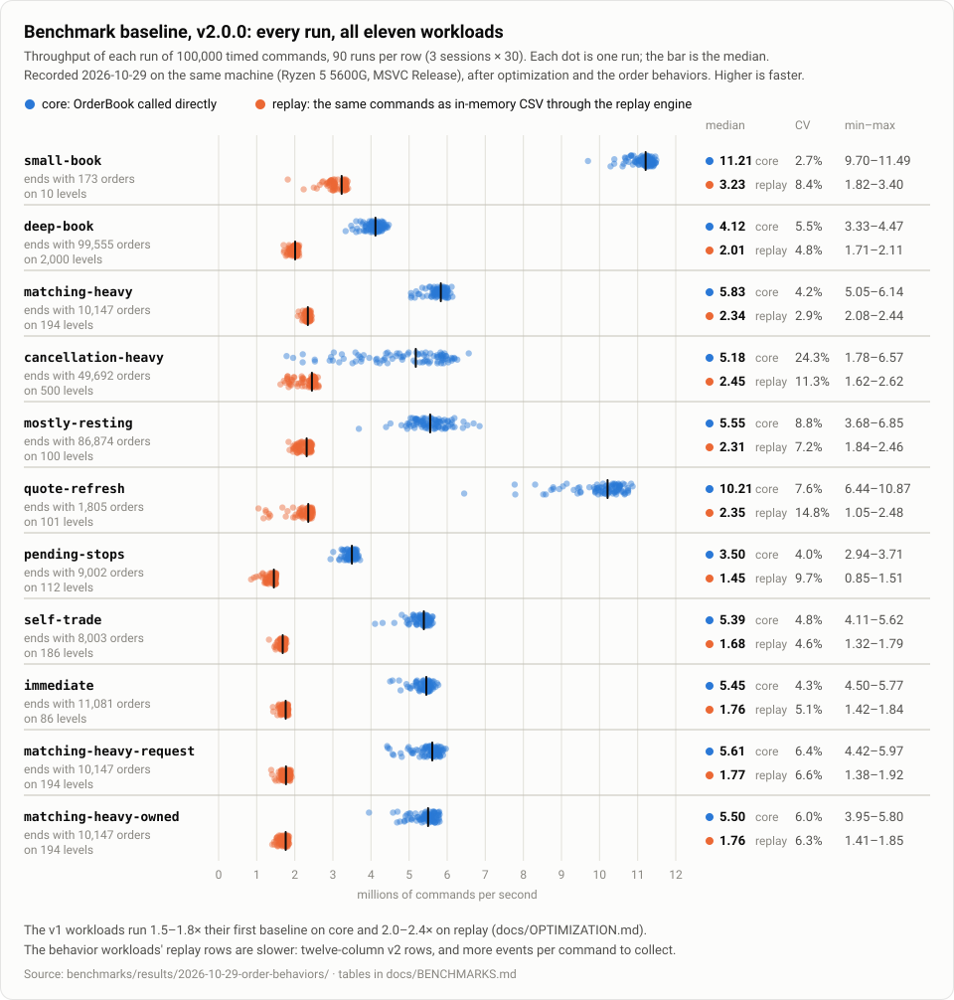

# Benchmark baselines

Recorded throughput of the order book, taken with `order_book_benchmarks` on one desktop machine. Each baseline is a reference point for later changes to this code on this machine. It is not a measure of how the engine compares with any other system. How the harness works is in [`benchmarks/README.md`](../benchmarks/README.md). This page records what was run, what came out, and how far the numbers can be trusted.

There are two. The current one, for v2.0.0, covers all eleven workloads: the five v1 workloads and the six behavior workloads. The first, from 2026-10-25, predates both the optimizations in [`OPTIMIZATION.md`](OPTIMIZATION.md) and the order behaviors, and is kept below as history. The two are not comparable as a before and after: the code, the generator version, and the index's sizing hint all changed between them. The before-and-after comparisons are paired, interleaved runs of two binaries, in [`OPTIMIZATION.md`](OPTIMIZATION.md).

## The v2.0.0 baseline (2026-10-29)

| | |
|---|---|
| Date | 2026-10-29 |
| Code | commit `f7db5b5` on `main` (the code released as v2.0.0) |
| Workload generator | version 3, seed 42 |
| Build | MSVC 19.44.35228, Release (`/O2 /Ob2 /DNDEBUG`), no automatic invariant checks, no sanitizers |
| Machine | the reference machine in [`benchmarks/README.md`](../benchmarks/README.md#environment), as for the first baseline |
| Raw results | [`benchmarks/results/2026-10-29-order-behaviors/`](../benchmarks/results/2026-10-29-order-behaviors/) |



### Standard size (100,000 timed commands per run)

Three sessions, each with 1 warm-up and 30 measured runs per workload and kind, so 90 measured runs per row. Throughput is in millions of commands per second (Mops/s). Warm-ups are left out. The columns are as in the first baseline ([below](#standard-size-100000-timed-commands-per-run-1)).

| Workload | Kind | Median Mops/s | ns/command at the median | p10 – p90 Mops/s | Min – max Mops/s | CV | Session medians |
|---|---|---:|---:|---|---|---:|---|
| `small-book` | core | **11.21** | 89 | 10.75 – 11.41 | 9.70 – 11.49 | 2.7% | 11.21 / 11.16 / 11.37 |
| `small-book` | replay | **3.23** | 310 | 2.86 – 3.34 | 1.82 – 3.40 | 8.4% | 3.27 / 3.00 / 3.30 |
| `deep-book` | core | **4.12** | 243 | 3.79 – 4.32 | 3.33 – 4.47 | 5.5% | 4.17 / 3.94 / 4.17 |
| `deep-book` | replay | **2.01** | 498 | 1.85 – 2.07 | 1.71 – 2.11 | 4.8% | 1.99 / 2.01 / 2.01 |
| `matching-heavy` | core | **5.83** | 171 | 5.43 – 5.99 | 5.05 – 6.14 | 4.2% | 5.87 / 5.84 / 5.79 |
| `matching-heavy` | replay | **2.34** | 427 | 2.25 – 2.40 | 2.08 – 2.44 | 2.9% | 2.37 / 2.34 / 2.33 |
| `cancellation-heavy` | core | **5.18** | 193 | 3.02 – 5.98 | 1.78 – 6.57 | 24.3% | 3.59 / 5.83 / 5.32 |
| `cancellation-heavy` | replay | **2.45** | 408 | 1.85 – 2.54 | 1.62 – 2.62 | 11.3% | 1.98 / 2.50 / 2.46 |
| `mostly-resting` | core | **5.55** | 180 | 5.04 – 6.12 | 3.68 – 6.85 | 8.8% | 5.20 / 5.77 / 5.68 |
| `mostly-resting` | replay | **2.31** | 432 | 2.03 – 2.42 | 1.84 – 2.46 | 7.2% | 2.08 / 2.35 / 2.38 |
| `quote-refresh` | core | **10.21** | 98 | 8.93 – 10.64 | 6.44 – 10.87 | 7.6% | 10.16 / 10.33 / 10.18 |
| `quote-refresh` | replay | **2.35** | 425 | 1.81 – 2.44 | 1.05 – 2.48 | 14.8% | 2.13 / 2.39 / 2.39 |
| `pending-stops` | core | **3.50** | 286 | 3.30 – 3.61 | 2.94 – 3.71 | 4.0% | 3.50 / 3.50 / 3.49 |
| `pending-stops` | replay | **1.45** | 690 | 1.23 – 1.50 | 0.85 – 1.51 | 9.7% | 1.32 / 1.49 / 1.47 |
| `self-trade` | core | **5.39** | 186 | 5.02 – 5.54 | 4.11 – 5.62 | 4.8% | 5.47 / 5.29 / 5.37 |
| `self-trade` | replay | **1.68** | 594 | 1.61 – 1.75 | 1.32 – 1.79 | 4.6% | 1.63 / 1.73 / 1.71 |
| `immediate` | core | **5.45** | 183 | 5.17 – 5.60 | 4.50 – 5.77 | 4.3% | 5.48 / 5.42 / 5.47 |
| `immediate` | replay | **1.76** | 568 | 1.62 – 1.82 | 1.42 – 1.84 | 5.1% | 1.65 / 1.78 / 1.79 |
| `matching-heavy-request` | core | **5.61** | 178 | 5.03 – 5.81 | 4.42 – 5.97 | 6.4% | 5.54 / 5.69 / 5.64 |
| `matching-heavy-request` | replay | **1.77** | 566 | 1.63 – 1.88 | 1.38 – 1.92 | 6.6% | 1.67 / 1.84 / 1.85 |
| `matching-heavy-owned` | core | **5.50** | 182 | 4.96 – 5.75 | 3.95 – 5.80 | 6.0% | 5.55 / 5.49 / 5.48 |
| `matching-heavy-owned` | replay | **1.76** | 568 | 1.55 – 1.81 | 1.41 – 1.85 | 6.3% | 1.62 / 1.79 / 1.79 |

Every run's outcome matched the workload's prediction, including the behavior workloads' expirations, prevented self-trades, triggered stops, and pending stops. At this size the books end with:

- `small-book`: 173 orders, 10 levels
- `deep-book`: 99,555 orders, 2,000 levels
- `matching-heavy`: 10,147 orders, 194 levels
- `cancellation-heavy`: 49,692 orders, 500 levels
- `mostly-resting`: 86,874 orders, 100 levels
- `quote-refresh`: 1,805 orders, 101 levels
- `pending-stops`: 9,002 orders, 112 levels, 4,494 pending stops
- `self-trade`: 8,003 orders, 186 levels
- `immediate`: 11,081 orders, 86 levels
- `matching-heavy-request`: 10,147 orders, 194 levels
- `matching-heavy-owned`: 10,147 orders, 194 levels

- **The v1 workloads** run 1.5 to 1.8 times their first baseline's medians on `core` and 2.0 to 2.4 times on `replay`: the effect of the optimizations (whose interleaved measurements are in `OPTIMIZATION.md`; `mostly-resting`'s also includes the index's sizing hint, added after the first baseline), less the small cost the order behaviors left on v1 traffic ([`OPTIMIZATION.md`](OPTIMIZATION.md#the-v200-regression-check)). Sessions days apart are only a rough comparison; the paired runs are the measurement.
- **The request path** (`matching-heavy-request`, the same stream as `matching-heavy` through `submitOrder(OrderRequest)`) costs about 4% on `core`. Its `replay` row is slower than `matching-heavy`'s because its rows are twelve-column v2 rows, not because the book does more.
- **The owner probe** costs nothing measurable: `matching-heavy-owned` is within 2% of `-request`, as the paired measurement in `OPTIMIZATION.md` found.
- **`cancellation-heavy` core** is the noisiest row (CV 24%): its first session's median is 3.59 Mops/s against 5.83 and 5.32 in the next two. Treat its median as approximate.

### Cost of the replay layers

| Workload | core ns/command | replay ns/command | Difference |
|---|---:|---:|---:|
| `small-book` | 89 | 310 | 221 |
| `deep-book` | 243 | 498 | 255 |
| `matching-heavy` | 171 | 427 | 255 |
| `cancellation-heavy` | 193 | 408 | 215 |
| `mostly-resting` | 180 | 432 | 252 |
| `quote-refresh` | 98 | 425 | 327 |
| `pending-stops` | 286 | 690 | 404 |
| `self-trade` | 186 | 594 | 408 |
| `immediate` | 183 | 568 | 384 |
| `matching-heavy-request` | 178 | 566 | 387 |
| `matching-heavy-owned` | 182 | 568 | 386 |

The v1 workloads' replay layers now add about 215–255 ns per command, down from 580–650 in the first baseline, after the replay experiments of `OPTIMIZATION.md`. The behavior workloads' add 330–410 ns: their rows have twelve fields, and their commands make more events (expirations, preventions, triggered stops) to collect.

### Extended size (1,000,000 timed commands per run)

One session with 1 warm-up and 5 measured runs per workload and kind.

| Workload | Kind | Median Mops/s | ns/command at the median | Min – max Mops/s | Final book |
|---|---|---:|---:|---|---|
| `small-book` | core | 11.00 | 91 | 9.46 – 11.15 | 194 orders, 11 levels |
| `small-book` | replay | 3.35 | 299 | 3.34 – 3.37 |  |
| `deep-book` | core | 4.02 | 249 | 3.91 – 4.06 | 98,611 orders, 2,001 levels |
| `deep-book` | replay | 2.00 | 499 | 1.72 – 2.14 |  |
| `matching-heavy` | core | 5.48 | 183 | 5.43 – 5.50 | 11,201 orders, 198 levels |
| `matching-heavy` | replay | 2.37 | 422 | 2.34 – 2.40 |  |
| `cancellation-heavy` | core | 6.79 | 147 | 6.08 – 7.37 | 49,808 orders, 500 levels |
| `cancellation-heavy` | replay | 2.73 | 366 | 2.62 – 2.81 |  |
| `mostly-resting` | core | 4.57 | 219 | 4.45 – 4.69 | 862,963 orders, 100 levels |
| `mostly-resting` | replay | 2.20 | 454 | 1.98 – 2.24 |  |
| `quote-refresh` | core | 10.31 | 97 | 9.95 – 10.70 | 1,805 orders, 101 levels |
| `quote-refresh` | replay | 2.41 | 415 | 2.30 – 2.49 |  |
| `pending-stops` | core | 3.48 | 288 | 3.42 – 3.56 | 9,007 orders, 134 levels, 4,486 pending stops |
| `pending-stops` | replay | 1.50 | 666 | 1.37 – 1.52 |  |
| `self-trade` | core | 5.38 | 186 | 5.06 – 5.42 | 8,044 orders, 192 levels |
| `self-trade` | replay | 1.77 | 564 | 1.75 – 1.80 |  |
| `immediate` | core | 5.10 | 196 | 5.00 – 5.21 | 11,998 orders, 108 levels |
| `immediate` | replay | 1.81 | 554 | 1.76 – 1.82 |  |
| `matching-heavy-request` | core | 4.98 | 201 | 4.61 – 5.39 | 11,201 orders, 198 levels |
| `matching-heavy-request` | replay | 1.87 | 534 | 1.83 – 1.91 |  |
| `matching-heavy-owned` | core | 5.40 | 185 | 5.29 – 5.46 | 11,201 orders, 198 levels |
| `matching-heavy-owned` | replay | 1.77 | 564 | 1.73 – 1.81 |  |

Every steady-state workload keeps its book's shape at this size. `mostly-resting` grows as designed, to about 863,000 orders. `pending-stops` and `immediate` end with more levels than at the standard size (134 and 108, against 112 and 86) but stay in the range their bounds hold them to (`benchmarks/README.md`).

### How it was run

From `benchmarks/results/2026-10-29-order-behaviors/`, against the Release build of the commit above:

```bash
for s in 1 2 3; do
  order_book_benchmarks --size standard --kind both --repetitions 30 --warmup 1 --seed 42 \
    --csv standard-session$s.csv --json standard-session$s.json > standard-session$s.txt
done
order_book_benchmarks --size extended --kind both --repetitions 5 --warmup 1 --seed 42 \
  --csv extended.csv --json extended.json > extended.txt
python summarize.py
```

The Debug and Release test suites (77 tests each) passed on the same code before the runs. The same directory holds the paired before-and-after runs against v1.0.0's code and the experiments between them; its README lists them.

## History: the first baseline (2026-10-25)

The first recorded throughput of the order book, before the optimizations of [`OPTIMIZATION.md`](OPTIMIZATION.md) and the order behaviors of v2.0.0, taken with `order_book_benchmarks` on one desktop machine. It is a reference point for later changes to this code on this machine. It is not a measure of how the engine compares with any other system. How the harness works is in [`benchmarks/README.md`](../benchmarks/README.md). This page summarizes that and records what was run, what came out, and how far the numbers can be trusted.

| | |
|---|---|
| Date | 2026-10-25 |
| Code | commit `e22a9b2` on `main`, clean working tree |
| Workload generator | version 2, seed 42 |
| Build | MSVC 19.44.35228, Release (`/O2 /Ob2 /DNDEBUG`), no automatic invariant checks, no sanitizers |
| Machine | the reference machine in [`benchmarks/README.md`](../benchmarks/README.md#environment): AMD Ryzen 5 5600G, 32 GiB DDR4-3200, Windows 11 Pro 10.0.26200, High performance power plan |
| Raw results | [`benchmarks/results/2026-10-25-baseline/`](../benchmarks/results/2026-10-25-baseline/) |

### Results


#### Standard size (100,000 timed commands per run)

Three sessions, each with 1 warm-up and 30 measured runs per workload and kind, so 90 measured runs per row. Throughput is in millions of commands per second (Mops/s). Warm-ups are left out.

| Workload | Kind | Median Mops/s | ns/command at the median | p10 – p90 Mops/s | Min – max Mops/s | CV | Session medians |
|---|---|---:|---:|---|---|---:|---|
| `small-book` | core | **6.30** | 159 | 6.02 – 6.45 | 4.79 – 6.49 | 4.4% | 6.26 / 6.26 / 6.35 |
| `small-book` | replay | **1.32** | 756 | 1.21 – 1.35 | 1.04 – 1.36 | 4.7% | 1.31 / 1.34 / 1.28 |
| `deep-book` | core | **2.24** | 446 | 1.80 – 2.43 | 1.34 – 2.65 | 11.3% | 1.90 / 2.28 / 2.33 |
| `deep-book` | replay | **0.91** | 1,101 | 0.83 – 0.96 | 0.76 – 0.98 | 5.8% | 0.90 / 0.89 / 0.95 |
| `matching-heavy` | core | **3.84** | 261 | 3.33 – 4.16 | 2.19 – 4.24 | 9.7% | 3.73 / 3.85 / 4.00 |
| `matching-heavy` | replay | **1.12** | 892 | 0.98 – 1.14 | 0.85 – 1.15 | 6.4% | 1.13 / 1.12 / 1.09 |
| `cancellation-heavy` | core | **3.02** | 332 | 2.26 – 3.51 | 1.38 – 3.92 | 17.6% | 2.91 / 2.55 / 3.40 |
| `cancellation-heavy` | replay | **1.06** | 944 | 0.90 – 1.14 | 0.40 – 1.15 | 10.5% | 1.08 / 1.00 / 1.11 |
| `mostly-resting` | core | **3.31** | 302 | 2.35 – 4.24 | 1.61 – 4.37 | 22.0% | 2.75 / 3.17 / 4.07 |
| `mostly-resting` | replay | **1.14** | 881 | 1.01 – 1.18 | 0.93 – 1.19 | 6.0% | 1.11 / 1.13 / 1.15 |

- **Median** is the median of the 90 runs' throughputs. **ns/command** is 10⁹ / median: the mean cost per command within a median run. It is not the latency of any single command.
- **p10 – p90** is the range of the middle 80% of runs (see [Percentiles](#percentiles)).
- **CV** is the coefficient of variation over all 90 runs (sample standard deviation / mean).
- **Session medians** are each session's own median, in run order. They show how far a result moves between sessions on the same machine and build.

Every run's outcome matched the workload's prediction (trades, volume, final resting orders and levels, no rejections). At this size the books end with: `small-book` 173 orders on 10 levels; `deep-book` 99,555 on 2,000; `matching-heavy` 10,147 on 194 (83,586 trades); `cancellation-heavy` 49,692 on 500 (no trades); `mostly-resting` 86,874 on 100.

#### Cost of the replay layers

`replay` runs the same commands as `core`, but as in-memory CSV through the parser and the replay engine, including event collection, the final snapshot, and the formatted summary. The difference at the medians is the cost of those layers per command:

| Workload | core ns/command | replay ns/command | Difference |
|---|---:|---:|---:|
| `small-book` | 159 | 756 | 597 |
| `deep-book` | 446 | 1,101 | 655 |
| `matching-heavy` | 261 | 892 | 632 |
| `cancellation-heavy` | 332 | 944 | 613 |
| `mostly-resting` | 302 | 881 | 579 |

The replay layers add roughly 580–650 ns per command whatever the workload. That is between about 1.5 and 4 times the engine's own cost, so the replay path's throughput mostly measures CSV parsing and event collection, not the book.

#### Extended size (1,000,000 timed commands per run)

One session with 1 warm-up and 5 measured runs per workload and kind. Five runs are too few for percentiles, so only the median and range are given.

| Workload | Kind | Median Mops/s | ns/command at the median | Min – max Mops/s | Final book |
|---|---|---:|---:|---|---|
| `small-book` | core | 6.36 | 157 | 6.17 – 6.40 | 194 orders, 11 levels |
| `small-book` | replay | 1.27 | 787 | 1.22 – 1.33 | |
| `deep-book` | core | 1.99 | 503 | 1.73 – 2.04 | 98,611 orders, 2,001 levels |
| `deep-book` | replay | 0.92 | 1,083 | 0.86 – 0.93 | |
| `matching-heavy` | core | 4.00 | 250 | 3.76 – 4.06 | 11,201 orders, 198 levels |
| `matching-heavy` | replay | 1.12 | 896 | 0.98 – 1.13 | |
| `cancellation-heavy` | core | 3.35 | 299 | 3.21 – 3.41 | 49,808 orders, 500 levels |
| `cancellation-heavy` | replay | 1.12 | 897 | 0.94 – 1.13 | |
| `mostly-resting` | core | 2.27 | 440 | 2.23 – 2.30 | 862,963 orders, 100 levels |
| `mostly-resting` | replay | 0.93 | 1,072 | 0.86 – 0.94 | |

The four steady-state workloads keep their book's shape at this size, and every one of their medians lies within the p10 – p90 range of their standard-size runs. `mostly-resting` is the exception by design: it grows the book, here to about 863,000 orders, ten times its size at the standard size. Its cost per command rises from about 300 to 440 ns, as its working set grows about tenfold; this baseline does not isolate the cause. Its results therefore depend on the run length and are only comparable at the same size.

## Percentiles

The harness reads the clock twice per run, before the first timed command and after the last. It measures how long a run of 100,000 or 1,000,000 commands takes, not how long any one command takes. So:

- **Per-run throughput percentiles are reported**, at the standard size only. Each run's throughput is measured correctly: a run lasts at least 15 ms against a 100 ns clock tick. Ninety runs per row support p10 and p90, with nine runs beyond each. They are computed by linear interpolation between closest ranks (Python's `statistics.quantiles`, `method="inclusive"`). Higher percentiles such as p99 would rest on less than one run and are not given. At the extended size, five runs support only a median and a range.
- **Per-command latency percentiles (p50, p99, p99.9 of a single command) are not reported**, because they were not measured. Dividing a run's time by its commands gives a mean, which says nothing about the tail. Timing each command separately would need a different harness: commands here take about 150–1,100 ns, comparable to the 100 ns tick of `steady_clock` on this machine and to the cost of reading it, so the clock itself would distort the result. Any latency-percentile figure would need that harness first.

## Methodology

The harness is described fully in [`benchmarks/README.md`](../benchmarks/README.md). In short:

- **Workloads.** The five v1 workloads (`small-book`, `deep-book`, `matching-heavy`, `cancellation-heavy`, `mostly-resting`), each a preload plus a mix of limit-order submissions and cancellations with its own cancellation rate, price placement, and quantity sizes; and, in the v2.0.0 baseline, the six behavior workloads, which add requests, replaces, stops, and owners (`benchmarks/README.md`). Each is generated in full from its configuration and the seed before anything is timed, by a generator that follows its own model of the book and never touches `OrderBook`. The same generator version and seed give the same commands on every platform.
- **What is timed.** Each run builds a fresh book and applies the preload untimed. It then times every command with `std::chrono::steady_clock`, checks the outcome against the generator's prediction untimed, and destroys the book. `core` calls `submitOrder` and `cancelOrder` directly. `replay` parses the same commands as CSV text in memory through `ReplayEngine` with invariant validation off. Disk I/O is excluded from both.
- **Repetition.** One warm-up run per workload and kind, recorded in the raw files but left out of every statistic, then the measured runs. Every run starts from a fresh book.
- **Both baselines.** Standard size: three back-to-back sessions of 30 measured runs, pooled to 90 per row, so the result does not rest on one session. Extended size: one session of 5 measured runs, as a check that results hold at a larger scale.
- **Statistics.** Medians rather than means, since a run disturbed by the machine is almost always slower, and the median is not pulled down by a few such runs. Each baseline's `summarize.py` ([2026-10-29](../benchmarks/results/2026-10-29-order-behaviors/summarize.py), [2026-10-25](../benchmarks/results/2026-10-25-baseline/summarize.py)) recomputes its tables from the raw CSV files.

The commands that produced the first baseline's raw results, run from `benchmarks/results/2026-10-25-baseline/` against the Release build of its commit:

```bash
for s in 1 2 3; do
  order_book_benchmarks --size standard --kind both --repetitions 30 --warmup 1 --seed 42 \
    --csv standard-session$s.csv --json standard-session$s.json > standard-session$s.txt
done
order_book_benchmarks --size extended --kind both --repetitions 5 --warmup 1 --seed 42 \
  --csv extended.csv --json extended.json > extended.txt
python summarize.py
```

Each `.csv` holds every run, warm-ups included. Each `.json` holds the whole session: build, each workload's configuration, fingerprint and predicted outcome, summaries, and every run. Each `.txt` is the program's console output. Its line endings are CRLF, because the program wrote its console output in text mode on Windows until a later commit switched it to binary. The Release test suite (`ctest -C Release`, 63 tests) passed on the same build before the runs.

## Limitations

- **One machine, one compiler, one build.** Every number comes from a single Windows desktop with MSVC and CMake's default Release flags: no link-time optimization, no profile-guided optimization, no `/arch` option. GCC or Clang builds, other flags, other CPUs, or other memory systems will give different numbers, possibly ordered differently between workloads. Compare later results with these only when they are taken in the same environment.
- **Noise.** The benchmark runs on one thread, without core pinning or raised priority. The runs were launched from an agent session in a terminal, and other background activity on the machine was not controlled. The noise is visible in the results. `small-book`, whose book fits in cache, is stable (CV 4.4%, session medians within 1%). The `core` runs of the large-book workloads are not. Their session medians differ by 23% (`deep-book`), 34% (`cancellation-heavy`), and 48% (`mostly-resting`), with CVs of 11–22%. Throughput can also shift partway through a session rather than scatter around one value: in session 1, the median `deep-book` `core` run is 2.20 Mops/s over the first 12 runs and 1.82 over the last 18 (see the `.csv` files, in run order). For those workloads, a difference smaller than the spread of their session medians is not evidence of a change. Confirming a change needs several sessions of the old and new code, interleaved on a quiet machine.
- **Short runs.** A standard-size `core` run typically lasts 15–50 ms, short enough that one scheduler interruption or frequency change moves it visibly. The `replay` runs typically last 75–115 ms and are steadier, plausibly for that reason.
- **Throughput, not latency.** Nothing here measures how long one command takes, and the tail in particular (see [Percentiles](#percentiles)). The book is single-threaded and is driven from a loop in the same process: no network, no message decoding, no concurrent clients, no persistence or recovery.
- **Synthetic workloads.** The workloads are generated mixes chosen to stress particular parts of the book: overhead, a large working set, matching, the order index, growth, and in v2.0.0 replaces, stops, self-trade prevention, and immediate orders. They are not recordings of real market activity. They use a fresh ID for every order and a single symbol; the v1 workloads use limit orders only. Real order flow has bursts, correlated cancellations, and a very different price and size distribution.
- **Fresh books and allocator state.** Every run starts from a newly preloaded book, in a process whose heap has been through earlier runs. The cost of the preload is excluded, and the allocator's state carries over between runs, which may account for part of the drift in the large-book workloads.
- **`mostly-resting` grows by design**, so its numbers depend on the run length (see [Extended size](#extended-size-1000000-timed-commands-per-run-1)).
- **Generator version.** Each baseline holds for its own workload generator version (2 for the first, 3 for v2.0.0) and seed 42 only; version 3 left the five v1 workloads' commands unchanged. A change to the generator bumps its version and makes earlier results incomparable.

## What these numbers do not show

They are not a comparison with any production exchange, trading venue, or commercial matching engine, and should not be presented as one. Such systems do different work (many symbols, order types, risk checks, networking, persistence, replication, regulatory recording) on different hardware under different load, and their published figures are measured in other ways. Nothing on this page supports a claim of being "low latency", "microsecond", or "exchange grade", or any claim about tail latency. What the numbers do support is narrower: on this machine and build, with these synthetic workloads, the engine processes a few million commands per second in one thread. They also give a reference for measuring later changes to this code in the same environment.
