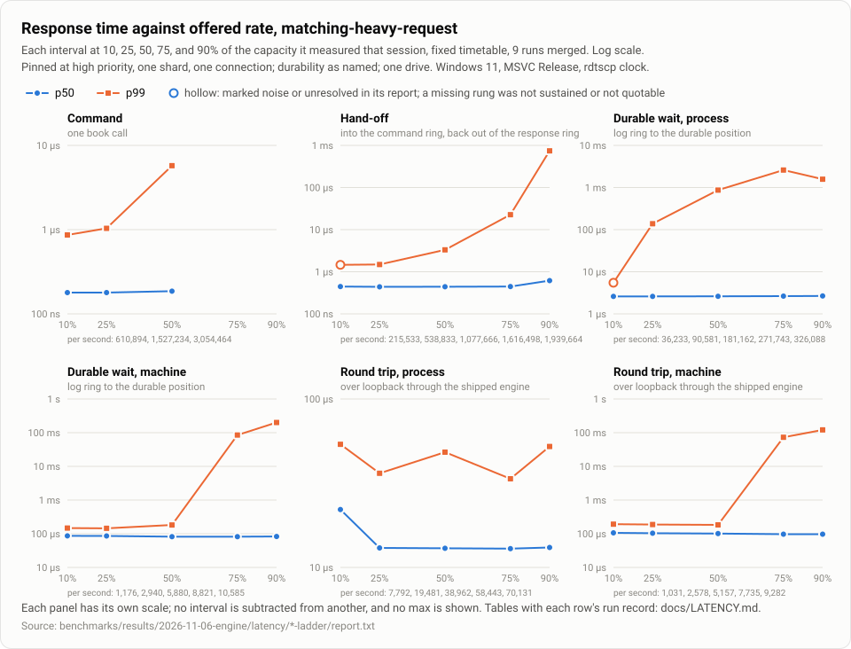

# Latency

What one command takes, measured under the rules below. The method is in [`benchmarks/latency/README.md`](../benchmarks/latency/README.md).

v2.1.0's recorded set was taken on 2026-11-06, in the same session as [`BENCHMARKS.md`](BENCHMARKS.md)'s engine set. V1's three decision rows (#96), which set defaults before any baseline existed, follow it.

## The claims rule

Every statement drawn from these results follows this rule, and so does anything quoting them.

**A report may say:** on this named machine and build, with this run record, this interval had these percentiles at this rate, and a change moved them by more than A/A.

**A report must refuse:**

- "low latency", "microsecond", or "exchange grade", in any form;
- any comparison with an exchange or another system;
- "wire-to-wire" or anything implying a network, since loopback is not one;
- a number without its interval and run record, or a single headline number;
- subtracting one interval from another;
- attributing a marked noise-floor percentile to the engine, or treating max as a guarantee;
- any `not sustained` rate quoted as a capability;
- any Linux or other-machine claim drawn from these runs, and any number from the Linux sanity workflow, which runs on shared GitHub runners;
- quoting a `steady_clock` result or the throughput harness's ns/command as latency.

## Linux

No Linux numbers are recorded for v2.1.0. Linux is built and tested in CI. The manual Linux sanity workflow (`.github/workflows/linux-sanity.yml`) checks for large effects only, on shared GitHub runners, and its runs are never quoted.

## Intervals

| Interval | From | To |
|---|---|---|
| **Command** | Before one book call | After it returns |
| **Hand-off** | Into the command ring | Back out of the response ring |
| **Round trip** | Scheduled send, over loopback through the shipped engine | Frame flagged last |
| **Durable wait** | A record enters the log ring | The durable position covers it |

All four intervals exist.
- **What a pinned row pins.**
  - A hand-off row pins the sender with `--pin-core` and the matching thread with `--matching-core`.
  - A durable-wait row pins the sender and the log writer, the writer with `--writer-core`.
  - A round-trip row pins four threads: the sender, the receiver with `--receiver-core`, and the engine's matching and gateway threads with `--matching-core` and `--gateway-core`. The engine's log writer, housekeeping thread, and roll worker are left unpinned.
- **What each row names.** A durable-wait or round-trip row names its durability, `machine` unless `--durability process` says otherwise. It also says whether checkpoints share the log's drive.

## The recorded set (2026-11-06)

**The run record every row shares:**
- **Machine.** An AMD Ryzen 5 5600G with 6 cores, SMT on, and 31.8 GiB, and a WD Blue SN570 NVMe drive, the machine's only drive. Windows 11 Pro 10.0.26200 on the High performance plan.
- **Build.** Commit `2affa3b`, MSVC 19.44 Release.
- **Clock.** `rdtscp;lfence`, with a 10 ns step and an empty pair's p50 of 20 ns.
- **Runs.** Each row is 9 runs merged. A percentile prints only with at least 1,000 samples beyond it. A mark from the report stays beside its figure: `noise` where the machine's own gaps are about as frequent as that percentile's tail, `unresolved` where the figure is within a few clock steps of the empty pair.
- **Workload.** `matching-heavy-request` unless the row is named for another.
- **Pins.** Every thread the harness runs is pinned at high priority, the sender on logical processor 6. A matching thread, or a durable-wait row's log writer, is on 10, the engine's gateway thread on 8, and the receiver on 4. Each sits on a different physical core. In the round-trip rows the engine's log writer, housekeeping thread, and roll worker are unpinned.

**Where it is.** Each row's own record, noise floors, and per-run figures are in [`benchmarks/results/2026-11-06-engine/latency/`](../benchmarks/results/2026-11-06-engine/latency/)`<row>/report.txt`, beside `runs.csv` and the raw counts. `summary.md` there tabulates them.

**Two cautions apply to whole rows:**
- **The durable-wait rows pin the log writer.** V1 found that on this machine a pinned, spinning, high-priority log writer stalls in ways the engine's unpinned writer doesn't ([below](#10ks-durable-wait)). So a durable-wait row's tail is not the engine's. The round-trip rows leave the engine's writer unpinned, as it ships.
- **A round-trip run's records, 100k to 1M of them at 40 bytes, fill none of the engine's 256 MiB log files.** So no roll pass runs, and no checkpoint is written during a run; the engine writes its empty books' checkpoints before the run starts. Those records say `no checkpoints until roll-forward lands`, a stale reason for the same fact, since corrected in the harness.

### Closed loop

Service time, one command at a time, 1M commands a run.

| Row | Samples | p50 | p99 | p99.9 | Quotable |
|---|---:|---:|---:|---:|---|
| `command-small-book` | 9,000,000 | 90 ns | 260 ns | 351 ns | yes |
| `command-deep-book` | 9,000,000 | 151 ns | 511 ns | 1.45 µs | yes |
| `command-matching-heavy` | 9,000,000 | 130 ns | 722 ns | 1.37 µs | yes |
| `command-cancellation-heavy` | 9,000,000 | 90 ns | 201 ns | 431 ns | yes |
| `command-mostly-resting` | 9,000,000 | 180 ns | 472 ns | 1.41 µs | yes |
| `command-quote-refresh` | 9,000,000 | 100 ns | 381 ns | 902 ns | yes |
| `command-pending-stops` | 9,000,000 | 161 ns | 2.00 µs | 9.52 µs | yes |
| `command-self-trade` | 9,000,000 | 140 ns | 673 ns | 1.41 µs | yes |
| `command-immediate` | 9,000,000 | 151 ns | 603 ns | 2.23 µs | yes |
| `command-matching-heavy-request` | 9,000,000 | 140 ns | 751 ns | 1.43 µs | yes |
| `command-matching-heavy-owned` | 9,000,000 | 140 ns | 751 ns | 1.44 µs | yes |

The rings and the shipped engine, closed loop. `round-trip-process` and the `machine` rows leave out the first 2 s of each run.

| Row | Samples | p50 | p99 | p99.9 | Quotable |
|---|---:|---:|---:|---:|---|
| `hand-off` | 9,000,000 | 381 ns | 1.18 µs | 2.07 µs, noise | yes |
| `round-trip-process` | 7,570,621 | 12.34 µs | 19.30 µs | 41.75 µs | yes |
| `round-trip-machine` | 8,818,230 | 92.95 µs | 160.69 µs | 251.01 µs | yes |
| `round-trip-machine-63-idle` | 8,852,458 | 115.53 µs | 184.84 µs | 315.08 µs | yes |

### Against rate

Response time, from each command's scheduled send, so a late send counts against it. Each ladder sends at shares of the capacity the same session measured: on a fixed timetable, and as a Poisson stream at 50%. A rate whose backlog grew is `not sustained` and is never a capability.

**Command**, one book call, 1M commands a run.

| Load | Rate | Samples | p50 | p99 | p99.9 | Quotable |
|---|---:|---:|---:|---:|---:|---|
| fixed at 10% | 610,894/s | 9,000,000 | 179 ns | 865 ns | 2.71 µs, noise | yes |
| fixed at 25% | 1,527,234/s | 9,000,000 | 179 ns | 1.04 µs | 6.07 µs, noise | yes |
| fixed at 50% | 3,054,464/s | 9,000,000 | 186 ns | 5.74 µs | 52.77 µs | yes |
| fixed at 75% | 4,293,209/s | 9,000,000 | - | - | - | no (not sustained) |
| fixed at 90% | 4,193,442/s | 9,000,000 | - | - | - | no (not sustained) |
| poisson at 50% | 3,059,051/s | 9,000,000 | 426 ns | 10.04 µs | 101.88 µs | yes |

**Command** on `pending-stops`, whose cascades make the long tail.

| Load | Rate | Samples | p50 | p99 | p99.9 | Quotable |
|---|---:|---:|---:|---:|---:|---|
| fixed at 10% | 431,808/s | 9,000,000 | 200 ns | 5.09 µs | 21.53 µs | yes |
| fixed at 25% | 1,079,520/s | 9,000,000 | 201 ns | 9.58 µs | 26.39 µs | yes |
| fixed at 50% | 2,159,041/s | 9,000,000 | 223 ns | 18.12 µs | 63.28 µs | yes |
| fixed at 75% | 3,229,261/s | 9,000,000 | - | - | - | no (not sustained) |
| fixed at 90% | 3,204,793/s | 9,000,000 | - | - | - | no (not sustained) |
| poisson at 50% | 2,162,284/s | 9,000,000 | 461 ns | 18.77 µs | 39.38 µs | yes |

**Hand-off**, through the rings and back, 1M commands a run.

| Load | Rate | Samples | p50 | p99 | p99.9 | Quotable |
|---|---:|---:|---:|---:|---:|---|
| fixed at 10% | 215,533/s | 9,000,000 | 445 ns | 1.46 µs, noise | 4.59 µs, noise | yes |
| fixed at 25% | 538,833/s | 9,000,000 | 439 ns | 1.49 µs | 7.02 µs, noise | yes |
| fixed at 50% | 1,077,666/s | 9,000,000 | 441 ns | 3.31 µs | 18.51 µs | yes |
| fixed at 75% | 1,616,498/s | 9,000,000 | 445 ns | 22.71 µs | 120.78 µs | yes |
| fixed at 90% | 1,939,664/s | 9,000,000 | 615 ns | 743.58 µs | 3.0 ms | yes |
| poisson at 50% | 1,079,285/s | 9,000,000 | 611 ns | 4.79 µs | 20.35 µs | yes |

**Durable wait at `process`**, files of 10,000 records, 100k commands a run. The writer is pinned, so the tail is not the engine's (see above).

| Load | Rate | Samples | p50 | p99 | p99.9 | Quotable |
|---|---:|---:|---:|---:|---:|---|
| fixed at 10% | 36,233/s | 900,000 | 2.59 µs | 5.48 µs, noise | not printed | yes |
| fixed at 25% | 90,581/s | 900,000 | 2.59 µs | 138.63 µs | not printed | yes |
| fixed at 50% | 181,162/s | 900,000 | 2.61 µs | 869.61 µs | not printed | yes |
| fixed at 75% | 271,743/s | 900,000 | 2.64 µs | 2.6 ms | not printed | yes |
| fixed at 90% | 326,088/s | 900,000 | 2.66 µs | 1.6 ms | not printed | yes |
| poisson at 50% | 180,849/s | 900,000 | 2.79 µs | 869.61 µs | not printed | yes |

The same, with a roll-forward worker rolling each file as it closes, from an empty book, its checkpoints in the log's directory.

| Load | Rate | Samples | p50 | p99 | p99.9 | Quotable |
|---|---:|---:|---:|---:|---:|---|
| fixed at 10% | 30,179/s | 900,000 | 2.59 µs | 1.6 ms | not printed | yes |
| fixed at 25% | 75,447/s | 900,000 | 2.61 µs | 3.6 ms | not printed | yes |
| fixed at 50% | 150,893/s | 900,000 | 2.62 µs | 4.4 ms | not printed | yes |
| fixed at 75% | 226,340/s | 900,000 | 2.71 µs | 5.5 ms | not printed | yes |
| fixed at 90% | 271,605/s | 900,000 | 1.2 ms | 8.0 ms | not printed | yes |
| poisson at 50% | 150,632/s | 900,000 | 2.81 µs | 4.3 ms | not printed | yes |

**Durable wait at `machine`**, as above. The writer is pinned.

| Load | Rate | Samples | p50 | p99 | p99.9 | Quotable |
|---|---:|---:|---:|---:|---:|---|
| fixed at 10% | 1,176/s | 900,000 | 86.65 µs | 147.04 µs | not printed | yes |
| fixed at 25% | 2,940/s | 900,000 | 86.12 µs | 144.94 µs | not printed | yes |
| fixed at 50% | 5,880/s | 900,000 | 81.92 µs | 181.69 µs | not printed | yes |
| fixed at 75% | 8,821/s | 900,000 | 81.92 µs | 85.0 ms | not printed | yes |
| fixed at 90% | 10,585/s | 900,000 | 82.97 µs | 201.1 ms | not printed | yes |
| poisson at 50% | 5,870/s | 900,000 | 96.10 µs | 462.11 µs | not printed | yes |

The same, with the rolling worker.

| Load | Rate | Samples | p50 | p99 | p99.9 | Quotable |
|---|---:|---:|---:|---:|---:|---|
| fixed at 10% | 1,146/s | 900,000 | 86.65 µs | 145.99 µs | not printed | yes |
| fixed at 25% | 2,864/s | 900,000 | 86.12 µs | 160.69 µs | not printed | yes |
| fixed at 50% | 5,728/s | 900,000 | 81.92 µs | 621.75 µs | not printed | yes |
| fixed at 75% | 8,592/s | 900,000 | 81.92 µs | 125.8 ms | not printed | yes |
| fixed at 90% | 10,310/s | 900,000 | 82.44 µs | 167.8 ms | not printed | yes |
| poisson at 50% | 5,718/s | 900,000 | 95.05 µs | 756.19 µs | not printed | yes |

**Round trip at `process`**, through the shipped engine, 300k commands a run. The 2 s not recorded at the start of each run would hold all of 100k commands at 75% and 90%, so this ladder alone was run again at this size after the session; its run record is the rerun's.

| Load | Rate | Samples | p50 | p99 | p99.9 | Quotable |
|---|---:|---:|---:|---:|---:|---|
| fixed at 10% | 7,792/s | 2,559,735 | 22.05 µs | 53.83 µs | 684.77 µs | yes |
| fixed at 25% | 19,481/s | 2,349,342 | 13.06 µs | 36.23 µs | 373.89 µs | yes |
| fixed at 50% | 38,962/s | 1,998,684 | 13.00 µs | 48.31 µs | 663.76 µs | yes |
| fixed at 75% | 58,443/s | 1,648,026 | 12.93 µs | 33.61 µs | 228.96 µs | yes |
| fixed at 90% | 70,131/s | 1,437,633 | 13.13 µs | 52.25 µs | 890.62 µs | yes |
| poisson at 50% | 39,027/s | 1,999,386 | 14.11 µs | 37.55 µs | 230.01 µs | yes |

**Round trip at `machine`**, 100k commands a run.

| Load | Rate | Samples | p50 | p99 | p99.9 | Quotable |
|---|---:|---:|---:|---:|---:|---|
| fixed at 10% | 1,031/s | 881,433 | 106.08 µs | 192.20 µs | not printed | yes |
| fixed at 25% | 2,578/s | 853,587 | 103.97 µs | 188.00 µs | not printed | yes |
| fixed at 50% | 5,157/s | 807,174 | 101.35 µs | 183.79 µs | not printed | yes |
| fixed at 75% | 7,735/s | 760,761 | 97.15 µs | 73.1 ms | not printed | yes |
| fixed at 90% | 9,282/s | 732,915 | 97.15 µs | 121.0 ms | not printed | yes |
| poisson at 50% | 5,148/s | 806,571 | 107.65 µs | 289.87 µs | not printed | yes |

**Round trip at `machine`, beside 63 idle connections** on the same gateway thread.

| Load | Rate | Samples | p50 | p99 | p99.9 | Quotable |
|---|---:|---:|---:|---:|---:|---|
| fixed at 10% | 826/s | 885,123 | 124.98 µs | 198.50 µs | not printed | yes |
| fixed at 25% | 2,065/s | 862,821 | 121.30 µs | 323.48 µs | not printed | yes |
| fixed at 50% | 4,130/s | 825,651 | 109.75 µs | 312.98 µs | not printed | yes |
| fixed at 75% | 6,195/s | 788,481 | 113.43 µs | 1.2 ms | not printed | yes |
| fixed at 90% | 7,434/s | 766,179 | 113.95 µs | 23.7 ms | not printed | yes |
| poisson at 50% | 4,123/s | 825,021 | 124.45 µs | 277.27 µs | not printed | yes |

### Waking an idle engine

At 50 commands a second, a 20 ms gap, each command finds the matching thread asleep past its spin window. 2,000 commands a run.

| Row | Rate | Samples | p50 | p99 | p99.9 | Quotable |
|---|---:|---:|---:|---:|---:|---|
| hand-off, fixed at 50/s | 50/s | 18,000 | 16.93 µs, noise | not printed | not printed | yes |
| round trip, `machine` | 50/s | 17,100 | 194.30 µs | not printed | not printed | yes |

### Zero heap: before and after

Command service time against v2.0.0's library, built into the harness at commit `17a8013`. There were four sessions in ABBA order, each 9 runs of 1M commands, and each side's figure is its two sessions' median. `matching_path_allocation_tests` passes: the matching path makes no heap call.

**The before side is a comparison, not a quotable row.** `17a8013`'s harness predates the run record's `capacity-growths` field, so every before row prints `quotable: no (missing capacity-growths)`. Its figures say only how v2.0.0's library compares with today's in one harness, and none is a latency claim of its own.

| Row | p50 before, ns | p50 now, ns | Ratio | p99 before, ns | p99 now, ns | Ratio |
|---|---:|---:|---:|---:|---:|---:|
| cancellation-heavy | 100 | 90 | 0.900 | 206 | 200 | 0.976 |
| deep-book | 175 | 151 | 0.863 | 556 | 522 | 0.940 |
| immediate | 151 | 151 | 1.000 | 660 | 611 | 0.926 |
| matching-heavy | 140 | 130 | 0.929 | 777 | 730 | 0.940 |
| matching-heavy-owned | 140 | 140 | 1.000 | 783 | 751 | 0.959 |
| matching-heavy-request | 140 | 140 | 1.000 | 783 | 746 | 0.953 |
| mostly-resting | 196 | 180 | 0.918 | 1058 | 466 | 0.441 |
| pending-stops | 180 | 161 | 0.894 | 2272 | 2072 | 0.912 |
| quote-refresh | 100 | 100 | 1.000 | 392 | 381 | 0.972 |
| self-trade | 151 | 140 | 0.927 | 714 | 673 | 0.943 |
| small-book | 90 | 90 | 1.000 | 291 | 266 | 0.912 |

No p50 is slower than before, and most are equal within one or two clock steps. Under V2's rule no difference is a valid result: the property is zero heap calls, which the allocation test checks, not a faster command.

## V1's decision rows (2026-11-05)

These three rows came before the recorded set, to decide defaults (#96, rules from #33). They were measured on 2026-11-05 on the reference machine: an AMD Ryzen 5 5600G with 6 cores, SMT on, and 31.8 GiB; a WD Blue SN570 NVMe drive, the machine's only drive; Windows 11 Pro 10.0.26200 on the High performance plan. The build was MSVC Release. Every row is `small-book`, and every pinned thread runs at high priority.

The raw results are in [`benchmarks/results/2026-11-05-latency-v1/`](../benchmarks/results/2026-11-05-latency-v1/): each session's `report.txt` with its run record, `runs.csv`, and the raw counts. `run.sh` and `run_unpinned.sh` made them, and `summarize.py` recomputes every figure below. Each row decides a default; none is a latency claim beyond its own run record.

### Spin window

The interval is hand-off response time on a fixed timetable: the gap is the time between scheduled sends. The sender is pinned to logical processor 6 and the matching thread to 10, on different physical cores. Each cell is the merged p50 over 9 runs, then the matching thread's share of a core in the median run.

| Window | 20 µs gap | 100 µs gap | 1 ms gap | 20 ms gap |
|---|---|---|---|---|
| `0` | 3.38 µs, 22.7% | 3.94 µs, 4.9% | 5.18 µs, 0.6% | 17.20 µs, 0.1% |
| `20us` | 0.43 µs, 99.8% | 3.61 µs, 24.6% | 4.76 µs, 2.6% | 17.07 µs, 0.2% |
| `100us` | 0.40 µs, 99.8% | 0.51 µs, 99.8% | 4.53 µs, 10.5% | 17.72 µs, 0.6% |
| `1ms` | 0.42 µs, 99.8% | 0.42 µs, 99.9% | 0.68 µs, 99.9% | 17.46 µs, 5.1% |
| `unlimited` | 0.42 µs, 99.9% | 0.43 µs, 99.9% | 0.85 µs, 99.8% | 4.86 µs, 99.8% |

At the 20 ms gap, each run holds 250 commands. The merged p50 therefore prints with only 1,125 samples beyond it, and it is marked `noise`.

**The rule:** the default becomes the smallest window whose p50 at the 20 µs gap is within A/A of `unlimited`.
- **The A/A band.** Three `unlimited` sessions were run at the 20 µs gap: in the sweep, straight after it, and after every other row. They gave 0.42, 0.41, and 0.41 µs.
- **What "within" means here.** The rule asks for a window that loses nothing against never sleeping. So a window counts as within A/A when its p50 is no slower than the band's top, 0.42 µs. Read two-sided, the rule would refuse a window for beating `unlimited`.
- **Each window:**
  - `0` (3.38 µs) is outside.
  - `20us` (0.43 µs) is outside: at a 20 µs gap its matching thread sometimes sleeps just before the next command arrives.
  - `100us` (0.40 µs) is within.
- **The result:** the default stays at `100us`. A two-sided reading would have chosen `1ms`, which keeps the matching thread at 99.9% of a core at a 1 ms gap, against `100us`'s 10.5%.

### Idle connections

The interval is a raw loopback echo with no gateway: one 64-byte message out and back, closed-loop service time, 9 runs of 50,000. The echo thread is on logical processor 10. Each cell is the merged p50.

| Socket set, echo thread's spin window | 0 idle | 16 idle | 64 idle | 256 idle | 1,024 idle |
|---|---|---|---|---|---|
| `WSAPoll`, `100us` | 6.14 µs | 8.86 µs | 17.72 µs | 71.94 µs | 562.94 µs |
| `WSAPoll`, `0` | 6.01 µs | 8.80 µs | 17.72 µs | 71.94 µs | 562.94 µs |
| completion ports, `100us` | 5.81 µs | 5.74 µs | 5.78 µs | 5.71 µs | 5.78 µs |
| completion ports, `0` | 5.78 µs | 5.68 µs | 5.81 µs | 5.58 µs | 5.71 µs |

**The rule:** at 64 idle connections, if `poll`'s p50 is more than twice the alternative's, the docs recommend that adapter and a follow-up issue is filed.
- **The result on Windows:** at the shipped spin window, `WSAPoll` is 17.72 µs against 5.78 µs on completion ports, 3.07 times. The rule fires.
- **The cost of each idle connection.** `WSAPoll` costs grow with every connection the gateway thread watches, about 0.18 µs per idle connection at 64 and 0.55 µs at 1,024. Completion ports stay flat.
- **What this means for operators.** The engine still ships `poll` only, capped at 64 connections per gateway thread. On Windows, a deployment with many connections should spread them over more gateway threads until the completion-port adapter lands: [#105](https://github.com/ThomasStatic/order-book/issues/105).
- **Linux.** The Linux verdict, `poll` against epoll, comes from the Linux sanity workflow, for large effects only, and is never quoted. Run 42128051178 found `poll` at 1.57 times epoll at 64 idle connections, under twice, so on Linux the rule does not fire and no epoll adapter is called for; past the 64-connection cap per gateway thread `poll` falls further behind (about 4.5 times at 256). Its Windows runner found `WSAPoll` at 2.97 times completion ports, as the reference machine did. Beside the durable wait at 1,000 a second, the raw loop's worst cases were of the same order on both runners, so no engine-only stall showed there either.

### 10k/s durable wait

The interval is durable wait response time at `machine`, at 10,000 records a second: five 60-second runs, 3,000,000 samples. Beside it runs the raw write-through loop at the same rate: one record per write, with no log writer, ring, or chain. Both get the same preparation, the current file and one made ahead, both extended or both zero-filled. With 5 runs and not 9, every row here is unquotable, and serves only the rule.

**The rule:** if the raw loop stalls the same way, it is the drive or the OS, documented as the environment. If only the engine stalls, it is a bug to find before the baseline is recorded. A stall here is the tail standing far off the middle, p99 or p99.9 over p50, more than twice the raw loop's ratio.

Unpinned, as the engine runs its log writer, with the merged figures over five runs:

| Row | Files | p50 | p99 | p99.9 | max | Each run's max: median, range |
|---|---|---|---|---|---|---|
| durable wait | extended | 83.5 µs | 147.3 ms | 190.4 ms | 197.3 ms | 196.2 ms, 132.3 to 197.3 ms |
| raw write loop | extended | 83.0 µs | 143.0 ms | 197.9 ms | 241.8 ms | 192.7 ms, 8.2 to 241.8 ms |
| durable wait | zero-filled | 43.6 µs | 82.4 µs | 213.2 µs | 13.4 ms | 1.9 ms, 0.7 to 13.4 ms |
| raw write loop | zero-filled | 43.1 µs | 87.2 µs | 146.3 ms | 186.4 ms | 186.3 ms, 0.6 to 186.4 ms |

**The result:** the raw loop stalls the same way on both kinds of file, so the stalls are the drive or the OS, and no engine-only stall stands in the way of the baseline.
- **Extended files:** p99 over p50 is 1,765 against the raw loop's 1,724.
- **Zero-filled files:** p99 over p50 is 1.9 against 2.0, and p99.9 over p50 is 4.9 against 3,397, where the raw loop met a drive stall the durable wait did not.

**The drive.** On extended files, as the engine makes them, write-through stalls on this drive reach 0.2–0.3 s, in the engine and in the raw loop alike, at p99 and beyond. Zero-filled files stall far less. ADR 0013's throwaway medians had extended files about 30 µs dearer per write, and the p50s here agree: 83.5 µs against 43.9 µs in the pinned durable wait. Those were medians, though, and this is the tail. That makes this drive and OS the environment for every `machine` row here: a durable-wait p99 on extended files is the drive's, and no figure from it describes the engine.

**Pinning the log writer.** The first pass pinned the log writer to a logical processor with the harness's `--writer-core`, as the hand-off row pins its matching thread. On zero-filled files the writer alone then stalled:
- In six interleaved single runs, every pinned engine run had a worst wait of 18.6 to 325 ms. The raw loop's worst in each of its runs was 1.3 to 2.3 ms.
- The same happened with the writer on logical processors 4 and 10. On 8, one run was clean.
- A writer that never slept stalled too, so the cause is not its wake-up.
- Unpinned, the writer's runs were as clean as the raw loop's.

The shipped engine never pins its log writer: it has no option to. So this is a cost of pinning a spinning high-priority thread on this machine, not the engine's. The pinned sessions and the interleaved runs are kept in the results, under `diagnosis/`. A pinned durable-wait row should not be read as the engine's.

## What can exceed these numbers

Three things can take a command past every percentile above. No quotable row grew or reached a far level: each one's run record shows `capacity-growths=0`, its book reserved to its peak. Only the `-rolling` durable-wait rows flushed images during a run, from a roll worker publishing checkpoints in the log's directory, and their run record says so.

These figures come from `order_book_component_benchmarks`, recorded in the same session on the same machine and build ([`components/`](../benchmarks/results/2026-11-06-engine/components/)). Each is one operation's cost, timed with `steady_clock` over all its passes and divided by them: a mean, not a percentile and not a latency, and never added to a latency row. The image rows are by the book's size in orders, as the CSV records it, not by the image's size in bytes.

| What | Size | Mean per operation | Passes |
|---|---|---:|---:|
| **A capacity growth:** the order index's `growTo`, from full | 12,288 orders | 0.15 ms | 5 |
| | 98,304 orders | 1.52 ms | 5 |
| | 786,432 orders | 14.25 ms | 5 |
| **A new level far from the touch:** inserted at the far end of a ladder of levels two ticks apart | 2,000 levels | 0.57 µs | 100 |
| | 20,000 levels | 5.01 µs | 100 |
| | 200,000 levels | 49.91 µs | 100 |
| **An image flush on the log's drive:** one checkpoint published, image written and flushed, `deep-book` | 1,000 orders | 1.25 ms | 5 |
| | 10,000 orders | 1.44 ms | 5 |
| | 100,000 orders | 4.37 ms | 5 |
| | 1,000,000 orders | 35.01 ms | 5 |

- **Growth.** v2.0.0's library, in the same program at commit `17a8013`, took 0.22 ms, 32.69 ms, and 280.18 ms for the same three growths (`capacity-before.csv`). Reserving a book to its peak, as `--instruments` does with each instrument's capacity, keeps growth off the matching path entirely.
- **Near the touch.** A new level next to the best price costs 0.11 to 0.12 µs at every one of those sizes. Only a level inserted far from it moves the rest of the side's array.
- **The flush and the matching thread.** A checkpoint is written by the roll worker, not the matching thread, so it can slow answers only by competing for the log's drive. The one drive here holds the log, the checkpoints, and the system, and no second drive was measured.
