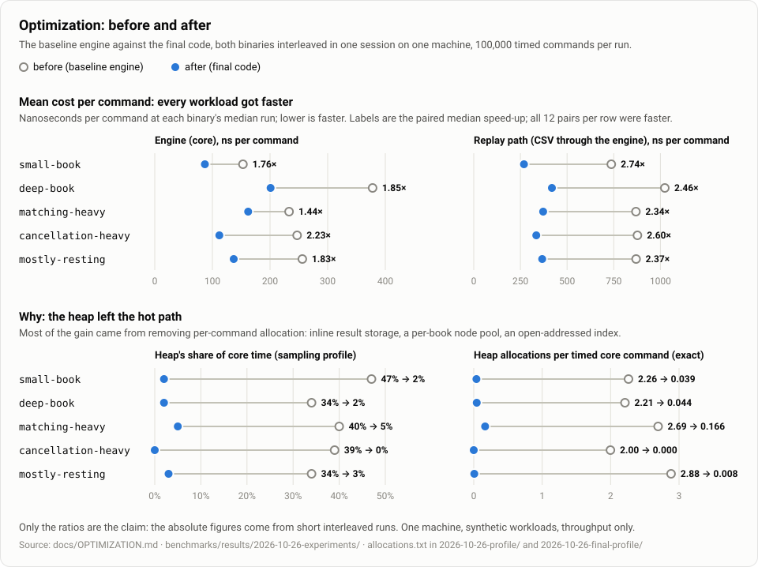

# Optimization report

What profiling found in the baseline engine, what was changed because of it, what that bought, and what it cost. This is the summary. Each experiment's prediction, measurement, review, and outcome are recorded in [`OPTIMIZATION-EXPERIMENTS.md`](OPTIMIZATION-EXPERIMENTS.md), and the baseline profile is written up in [`PROFILING.md`](PROFILING.md).

| | |
|---|---|
| Date | 2026-10-26 |
| Before | the baseline's engine, as profiled (commit `0a81fe2`, whose library code is that of `ab59f5c` and of the recorded baseline in [`BENCHMARKS.md`](BENCHMARKS.md)) |
| After | `main`, commits `8672a51` to `727ea96`: eight kept changes, plus the commits recording reverted experiment 3 and null experiment 7. The later fix for CI (`70ffeaa`, see Correctness) changes a path the benchmarks never take and was not re-measured |
| Build | MSVC 19.44, Release (`/O2 /Ob2 /DNDEBUG`), no LTO, no `/arch`, as in the baseline |
| Machine | the reference machine of [`benchmarks/README.md`](../benchmarks/README.md#environment) (Ryzen 5 5600G, Windows 11) |
| Raw results | comparisons in [`benchmarks/results/2026-10-26-experiments/`](../benchmarks/results/2026-10-26-experiments/); profiles before in [`2026-10-26-profile/`](../benchmarks/results/2026-10-26-profile/) and after in [`2026-10-26-final-profile/`](../benchmarks/results/2026-10-26-final-profile/) |

## Summary

- **Throughput rose on every workload.** The core path now runs 1.44 to 2.23 times as fast at the standard size (100,000 timed commands), and 1.43 to 2.41 times at the extended size. The replay path runs 2.34 to 2.87 times as fast. Every pair in these comparisons was faster: 120 pairs at the standard size and 60 at the extended size.
- **Most of the gain came from removing heap allocation.** The heap took 34-47% of the core path's time. It now takes 0-5%. A resting submission made 3 allocations and now makes none in the steady state; a cancellation made 1 and now makes none; parsing a replay record made 6 and now makes none.
- **Eight changes were kept.** One experiment was reverted (3) and one was a planned null experiment (7). One kept experiment was cut back after measurement and review: experiment 1's rollback rewrite was dropped.
- **Correctness held.** Every kept change passed the full suite in Debug, where every public command also checks the whole book's invariants, and in Release, plus both again under AddressSanitizer. Each was also read by an independent reviewer. No replay sample, expected output, saved regression stream, or workload fingerprint changed.
- **CI caught one problem the local gate could not.** GCC, Clang, and UBSan are not installed on this machine. Their first run, in CI, failed one test, `node_pool_tests`, in two builds. Both were problems in how the test counts allocations, not in the engine; the fix is described under Correctness, and every CI configuration now passes.

## What profiling revealed

The baseline was profiled with two tools written for it: an out-of-process sampling profiler, which reads inlined frames from the PDB, and an exact allocation counter, which replaces `operator new`. [`PROFILING.md`](PROFILING.md) has the method and the full tables. Three findings mattered:

1. **Per-command heap allocation was the largest cost everywhere.** The heap's own code (`RtlAllocateHeap`, `RtlFreeHeap`, and the CRT wrappers) was 34-47% of the core path's samples on every workload. It was the only large cost on the books that fit in cache. Allocations per command:
   - a resting submit made 3: its queue node, its index node, and the result's one-event vector;
   - a cancel made 1, the same one-event vector;
   - a matching submit made 2 to 6, including a trades vector reserved for four trades.

   Most of these existed only to hand back a result.
2. **The order index missed cache once the book was large.** `std::unordered_map`'s bucket walk was 4% of self time on `small-book`, whose index fits in L2. On the three large-book workloads it was 20-25%, with nothing else in the instruction stream changing. Each lookup made two dependent loads into a 2 MiB bucket array and into nodes scattered over the heap. Growing the table (`_Forced_rehash`) cost `mostly-resting` another 11%. The level map's tree walk (10-12% on `deep-book`) and the first touch of a cancelled order's node (5-7%) were the same effect in other structures.
3. **The replay path's cost was CSV tokenization, not the engine.** Parsing was 53-76% of the replay path. It allocated 6 times per record: a `std::vector<std::string>` grew five times for six fields, and `std::getline` allocated the line. It also fetched characters one virtual call at a time. Field validation itself (`parseRow`) was 7-10%.

Smaller items: a no-op `generatedTrades = {}` assignment in a constructor (about 2% of `small-book`), and a second index walk per submit and per cancel.

The profile also exposed a problem with the measurements. The first A/B protocol, alternating whole sessions of each binary, measured an identical binary 9% faster on one workload purely because it ran second. Every experiment was therefore judged by a paired, interleaved protocol instead (`benchmarks/compare_ab.py`). Each workload gets 16 pairs of short runs in ABBA order, and the result is the median ratio with a bootstrap 95% interval. Its noise floor, measured by comparing a binary with a copy of itself, is about ±3%.

## Before and after

### Throughput

The final code against the baseline engine, both binaries interleaved in one session. The ratio is the paired median, with its 95% interval in parentheses. The nanosecond figures are each binary's median over the same runs: 60 runs per binary at the standard size, 18 at the extended size.

| Workload | Kind | Before ns/command | After ns/command | Ratio, standard | Ratio, extended |
|---|---|---:|---:|---:|---:|
| `small-book` | core | 153 | 87 | **1.76** (1.74-1.78) | 1.78 (1.72-1.81) |
| `deep-book` | core | 378 | 201 | **1.85** (1.82-1.87) | 1.95 (1.86-1.97) |
| `matching-heavy` | core | 233 | 162 | **1.44** (1.43-1.45) | 1.43 (1.43-1.44) |
| `cancellation-heavy` | core | 247 | 112 | **2.23** (2.10-2.34) | 2.41 (2.26-2.55) |
| `mostly-resting` | core | 256 | 137 | **1.83** (1.75-2.01) | 1.96 (1.86-2.00) |
| `small-book` | replay | 737 | 269 | **2.74** (2.73-2.77) | 2.79 (2.77-2.82) |
| `deep-book` | replay | 1,024 | 419 | **2.46** (2.40-2.48) | 2.49 (2.46-2.52) |
| `matching-heavy` | replay | 869 | 372 | **2.34** (2.31-2.35) | 2.38 (2.37-2.39) |
| `cancellation-heavy` | replay | 877 | 335 | **2.60** (2.59-2.64) | 2.87 (2.84-2.98) |
| `mostly-resting` | replay | 870 | 367 | **2.37** (2.33-2.40) | 2.60 (2.58-2.70) |

Nanoseconds per command are the standard size's. They are the mean cost per command within a run, not the latency of any single command (see [`BENCHMARKS.md`](BENCHMARKS.md#percentiles)).

How far to trust these numbers:

- **Only the ratios are the claim.** The absolute numbers come from short interleaved invocations, not from [`BENCHMARKS.md`](BENCHMARKS.md)'s 90-run protocol. The "before" column differs from that baseline by up to 26% on the large-book workloads; the baseline recorded run-to-run variation of 11-22% on exactly those. A new baseline should be recorded with the full protocol before the absolute numbers are quoted.
- **Part of `mostly-resting`'s gain is the harness, not the engine.** The "before" binary's harness does not call `OrderBook::reserve` (experiment 2), so its index rehashes as the book grows.
- **Single machine, compiler, and synthetic workloads**, with the same limits as the baseline.

**The replay layers' cost per command fell from 584-646 ns to 182-230 ns.** That cost is the replay path's time minus the core path's on the same commands. At the baseline, the replay path's throughput measured mostly CSV handling. Now the engine is a third to a half of it.

### Allocations per command

Exact counts at the standard size, from `allocation_profile`, [before](../benchmarks/results/2026-10-26-profile/allocations.txt) and [after](../benchmarks/results/2026-10-26-final-profile/allocations.txt). Each range spans the five workloads.

| Command kind | Before | After | What is left |
|---|---:|---:|---|
| submit that rests without trading | 3.0-3.3 | 0.000-0.13 | a new price level's map node (80 bytes); the pool's chunks, 256 nodes at a time |
| submit that trades, then rests the remainder | 6.0-6.1 | 1.0-1.2 | the remainder's new price level |
| submit filled completely | 2.0-2.1 | 0.004-0.24 | sweeps of more than four trades, whose results spill to the heap |
| cancel | 1.0 | 0.000 | nothing: `cancelOrder` is now pinned allocation-free by a test |
| replay: parsing one record | 6.0 | 0.000 | the record vector's amortized growth |
| all timed commands, per command | 2.0-2.9 | 0.000-0.17 | `cancellation-heavy`'s 100,000 timed commands make no allocation at all |

### Where the time goes now

The same sampling profile, workloads, and run counts as the baseline's, on the final code (extended size). Shares are of the timed region's samples, and each cell is baseline → final.

| Self time, % | `small-book` | `deep-book` | `matching-heavy` | `cancellation-heavy` | `mostly-resting` |
|---|---:|---:|---:|---:|---:|
| heap (`ntdll`, `ucrtbase`) | 47 → 2 | 34 → 2 | 40 → 5 | 39 → 0 | 34 → 3 |
| order-index lookup (`_Find_last` → `OrderIndex::find`) | 4 → 4 | 25 → 35 | 10 → 10 | 20 → 25 | 22 → 51 |
| price-level map walk (`_Find_lower_bound`) | 5 → 6 | 12 → 12 | 4 → 6 | 10 → 12 | 5 → 9 |
| first touch of a resting order (`getRemainingQuantity`) | 1 → 3 | 5 → 8 | 2 → 3 | 7 → 8 | 1 → 3 |

A share that rises is a share of a much shorter command. The heap rows fell by 70-140 ns per command, estimated as share times the unprofiled time per command. The index rows are discussed under [What remains unoptimized](#what-remains-unoptimized).

### Contribution of each change

Each kept change, measured against the code the previous one left. The full tables are in [`OPTIMIZATION-EXPERIMENTS.md`](OPTIMIZATION-EXPERIMENTS.md#outcome).

| # | Change | Core | Replay |
|---|---|---|---|
| 1 | Remove a no-op assignment, move the snapshot's vectors | about +2% on `small-book`, else within noise | within noise |
| 2(a) | `OrderBook::reserve`, used by the benchmark before its untimed preload | `mostly-resting` +20% at the extended size, +3% at the standard | within noise |
| 4 | Inline storage for results' events and trades (`SmallVector`) | +13-19% | +3-5% |
| 5 | A level handle in each index entry, so a cancel skips the map search | `cancellation-heavy` +5-7% | — |
| 9(a) | Reuse the replay reader's line and row buffers | within noise (control) | +35-50% |
| 9(b) | Read replay input in 64 KiB chunks instead of `std::getline` | within noise (control) | +31-52% |
| 6 | A per-book node pool for the level queues | +11-29% | +7-10% |
| 8 | An open-addressed order index replacing `std::unordered_map` | +5-62% | +3-17% |

## A successful optimization: inline storage for results (experiment 4)

**The bottleneck.** Every command returned its events in a `std::vector<BookEvent>`, and every match built its trades in a `std::vector<Trade>` reserved for four. A resting submit or a cancel produces exactly one 20-byte event, yet each made a heap allocation for it and a free when the caller dropped the result. The profile charged `SubmissionResults::accepted` 19% inclusive on `small-book` and `matching-heavy`, nearly all of it this allocation. The vectors' destructors, which identical-code folding labels `~vector<BenchmarkCommand>`, took another 4-7%. `allocation_profile` counted these allocations exactly: 1 per resting submit, 1 per cancel, 2 per filled submit.

**The hypothesis.** A command makes few events and trades: one event for a resting submit or a cancel, and 1.2 to 2.1 trades per matching submit at the standard size, with sweeps past four rare. A container that holds a few elements inside itself and spills to the heap only beyond them would remove these allocations from the common path. It would change nothing about what a result contains.

**The change.** `SmallVector<T, N>` (`include/order_book/small_vector.hpp`, 190 lines) holds `N` trivially copyable elements inline and the rest on the heap. `SubmissionResults` keeps its trades in `SmallVector<Trade, 4>` and its events in `SmallVector<BookEvent, 5>`; `CancellationResult` keeps its one event in `SmallVector<BookEvent, 1>`. `matchOrder` builds its trades in the same type. It still makes room before each `executeOnce`, so recording a trade cannot throw after the book has changed. Restricting the type to trivially copyable elements kept it small: no element constructors or destructors to run, and copy and grow are `memcpy`. The getters return the new type, which iterates, indexes, compares equal with a `std::vector`, and binds to `std::span`. Copying it into a `std::vector` takes an explicit `toVector()`, so an allocation cannot creep back in unseen.

**The measurement** confirmed both the mechanism and the size of the effect:

- **Mechanism.** Allocations per command fell exactly as predicted: a resting submit from 3.0 to 2.0, a cancel from 1.0 to 0.0, and a filled submit from 2.0 to 0.0 up to four trades.
- **Size.** Throughput rose 18-19% on the cached workloads, every pair faster, inside the predicted 15-25%. It rose 15-19% on `deep-book` and `cancellation-heavy`, above the predicted 8-12%, and 9-13% on `mostly-resting`. The prediction had assumed an allocation costs the same everywhere. The heap behind a large book is slower, so each allocation removed saves more there.
- **Controls.** The replay path gained only 3-5%: the same absolute saving, set against parsing's larger cost. The order of events and trades, which was the correctness control, did not change: every event test and replay expected file passed untouched.

**The review** found no defect in the container's main paths or in the engine's contracts. It found four weaknesses in the first version, all fixed before the change was kept:

- **An implicit conversion to `std::vector`** that would let a copy happen silently.
- **A test that could not fail.** The aliasing test (`v.push_back(v[0])` while full) grew from inline storage, which is never freed. It now grows from the heap, and with the copy-before-grow line deleted, AddressSanitizer reports a use-after-free.
- **Missing bounds asserts and `std::launder`.**
- **A lost allocation-failure test for `cancelOrder`.** The old test required at least one allocation to fail, and `cancelOrder` no longer allocates. It was replaced by a test that pins `cancelOrder` as allocation-free, which `CLAUDE.md` now records as part of its contract.

**Why it is the clearest success.** It removed the cost the profile measured, by the mechanism predicted, by about the amount predicted, with no change in behavior. It is also the change that made `cancelOrder`'s strongest guarantee hold by construction: it cannot fail on allocation, because it no longer allocates.

## A rejected optimization: a single-lookup resting path (experiment 3)

**The bottleneck.** A resting submit walked the order index twice for the same ID. `validateNewOrder` looked it up to refuse a duplicate (10-22% inclusive), then `restOrder`'s `emplace` looked it up again to insert it. Removing one walk looked like a direct saving on the large-book workloads, where each walk could miss cache.

**Measured before it was built.** The plan required a ceiling measurement first. A throwaway build simply deleted the duplicate check. That is not correct code, but it bounds what any single-lookup design could gain. Its first run gave 6.6% on `deep-book` and 4.9% on `cancellation-heavy`, which cleared the plan's 3% threshold.

**The design that was built.** Submits that do not cross the book rest whole, so for those one `try_emplace` both refused a duplicate and created the index entry. The entry held a placeholder location, which was filled in once the order was queued and erased on any exception. Crossing submits kept the existing path, so `matching-heavy`'s fully filled submissions did not pay for an entry they would immediately remove.

**Why it was reverted.**

- **No measurable gain.** On its target workloads the design measured 0.97-1.02, within noise in two separate measurements.
- **The ceiling did not hold.** Rechecked with 24 pairs, it fell to about 3% on both targets, which is the noise floor. The explanation was in the library: MSVC's `emplace` already looks up the key before it allocates, so after the first walk the second one hit warm cache. There was never more than a few percent to recover.
- **Real costs, by the independent review.** The design was correct, but keeping it would have cost:
  - an index entry that, for a moment inside the command, pointed at nothing, a hazard for any future code that reads the index there;
  - the duplicate check living in three places instead of one;
  - a change to the sequence-number contract when the index allocation failed.

  The validate-match-rest structure that makes the submit path easy to state would have had an exception. For no measurable gain, that was not worth it.

**What was kept.** `testRestingSubmitRollsBack` in `allocation_failure_tests`, written to guard the design's cleanup. It fails each allocation in turn for a submission that rests without trading, and requires the book unchanged and the sequence number consumed. Breaking the cleanup on purpose made it fail. It now guards the committed `restOrder` rollback, which had no such test. The reverted diff is kept as [`exp3-reverted.diff`](../benchmarks/results/2026-10-26-experiments/exp3-reverted.diff).

**The lesson, applied to every later experiment.** The design was built on one run whose interval looked convincing. The ceiling then moved by as much as that interval between sessions. A single run's interval overstates its certainty, so every later result near the floor was rechecked before anything was decided on it.

Two other changes were rejected for related reasons. Experiment 1 rewrote `restOrder`'s rollback with nested `try` blocks instead of a `std::optional`. It measured the same with and without the rewrite and read slightly worse, so that part was reverted and the rest of the experiment kept. Experiment 7 was designed as a null result: it computed each level's aggregate quantity on demand instead of maintaining it. The core path did not move, as the profile predicted, and the replay path's final snapshot got 5% slower, so it was reverted. It also served as a check that the protocol reports nothing where there is nothing.

## Readability and performance trade-offs

The library's own code grew by about 820 lines net (906 added, 86 removed), almost all of it in three new headers. The tests grew by about 1,200 lines.

| Change | Gain | Code it added | Where the complexity lives | Kept because |
|---|---|---|---|---|
| 1. No-op work | ~2%, one workload | none (net shorter) | nowhere | it deletes code |
| 2(a). `reserve` | `mostly-resting` +20% at 1M commands | one method | a hint with no effect on what the book reports | negligible cost |
| 4. `SmallVector` | +13-19% | 190 lines | one header; two getters' return types | large gain, cost contained in one place |
| 5. Level handle | `cancellation-heavy` +5-7% | ~15 lines plus a guard | one pointer field with the same lifetime as the list iterator beside it | small gain at a small cost; the guard is stricter than before |
| 9(a)/(b). Replay reader | replay +35-52%, twice | ~80 lines | inside `ReplayReader`; one new public function | large gain; no public type changed |
| 6. Node pool | +11-29% | 179 lines | an allocator type in `OrderQueue`; a hand-written move assignment | large gain on every workload |
| 8. Open-addressed index | +5-62% | 277 lines | a hash table at the center of the engine | the largest single gain on the large books |

Rejected for readability against too little gain: experiment 3's design, experiment 1's rollback rewrite, and experiment 6's measurement build, a per-thread free list. It measured about as fast as the final pool on four workloads, and gained nothing on `mostly-resting`, but it would have handed a node freed on one thread to a list on another.

Principles that kept the cost down:

- **Keep the standard container's shape.** The node pool is an allocator, so the queues are still `std::list`, with its iterator stability, which the index depends on. `OrderIndex` exposes the subset of `std::unordered_map`'s interface the engine and tests used (`find`, `emplace`, `erase`, `at`, iteration). So the engine's code, the invariant checker, and the tests that reach the index changed little.
- **Measure a throwaway first.** Experiments 3, 6, and 8 each measured a quick version before anything was designed properly. Experiment 3's throwaway is what showed the design was not worth building; experiments 6 and 8 earned their complexity before it was written.
- **Write every new contract down.** Each new rule is stated in its header and in `CLAUDE.md`:
  - `cancelOrder` never allocates, and throws if an index entry's level handle is wrong;
  - a book keeps its peak node memory until it is destroyed, and a moved-from book uses the heap;
  - the index invalidates iterators on every emplace and erase, and its iteration order is unspecified;
  - the replay reader reads ahead of what it returns, so it needs a stream of its own;
  - results are not drop-in `std::vector`s.

What the performance cost in clarity, honestly:

- **`OrderIndex` is 277 lines of hand-written hashing** where a standard container used to be. Its correctness rests on a differential test against `std::unordered_map`, plus targeted tests for wrapped probe runs and failed growth. Its hash is not hardened: a caller that chooses IDs in a particular arithmetic progression can slow the book down, though not make it wrong. The header says so.
- **`OrderBook`'s move assignment is now written by hand.** A new member must be added to it, and nothing but review enforces that.
- **The node pool keeps memory.** It never returns chunks before the book is destroyed, so a book that spikes holds its peak.
- **`SmallVector` is a near-vector.** It has no `erase` or `insert`, and moving an inline result copies it, so a pointer into a result does not survive a move.

## The owner probe (v2.0.0)

Self-trade prevention (spec #40) checks, before each match of an incoming order that has an owner, whether the oldest resting order it would trade with has the same owner. The spec first put a resting order's owner in its index slot, in the four bytes of padding between the ID and its location, so neither `Order` nor the queue nodes grew. The probe then cost one index lookup per match: a hash, and on a large book a likely cache miss, against an order the matching loop is already reading. Spec #40's P2 set the rule before anything was measured: compare `matching-heavy-owned` (matching-heavy's exact stream through the request path, every order with its own owner, so the probe runs on every match and never prevents) with `matching-heavy-request` (the same stream, owner 0, so the probe never runs), on `core` under the measurement protocol, and move the owner into the queue node if owned is more than 5% slower.

| Comparison, `core`, standard size | Pairs | Median ratio | 95% CI | Faster in |
|---|---:|---:|---|---:|
| owned / request, owner in the index slot | 16 | 0.980 | 0.904 - 1.067 | 44% |
| the same, rerun | 32 | **0.947** | 0.940 - 0.963 | 12% |
| request / request (noise floor) | 16 | 0.991 | 0.968 - 1.008 | 31% |
| request / v1 `matching-heavy` (the request path's own cost) | 16 | 0.974 | 0.969 - 0.991 | 19% |
| owned / request, owner in the queue node | 32 | **0.999** | 0.993 - 1.011 | 47% |

Raw output in [`benchmarks/results/2026-10-29-owner-probe/`](../benchmarks/results/2026-10-29-owner-probe/). One binary throughout, run against itself on two workloads (`compare_ab.py --exp-workload`), so no difference in code placement enters.

- **Outcome.** The probe cost 5.3%, just past the threshold. The first 16 pairs were too noisy to decide (their early pairs ranged from 0.80 to 1.35), so the comparison was rerun with 32, whose later pairs held steady at 0.93-0.97.
- **The fallback.** A level's queue now holds `RestingOrder`s (`order_location.hpp`): the `Order` plus its `OwnerId`, a 56-byte node in place of 48, which takes a size class of the pool of its own. The probe reads the owner from the front node, and the index is searched only on an actual match, to remove the resting order. The index slot is a plain `{id, location}` again. `RestingOrder` converts from an `Order` and binds to an `Order&`, so the code that reads queues as orders, tests included, did not change.
- **What it cost the rest.** Against the slot-owner build (16 pairs each, `core`): `matching-heavy-owned` 1.055 (1.044-1.061, every pair faster), `matching-heavy-request` 1.001, and the five v1 workloads 0.976-1.002. `cancellation-heavy` and `mostly-resting` are the two at 0.976, inside the protocol's ±3% no-change band, and they are where a larger node would show: both touch a cancelled or newly rested node on nearly every command. The owner probe now costs nothing measurable (0.999).
- **Correctness.** The whole suite in Debug and Release, `allocation_failure_tests` included; the workload fingerprints are unchanged, since the generator is untouched.

## What remains unoptimized

From the final profile and allocation counts. These are opportunities, not plans; none has been measured.

1. **Order-index lookups still miss cache on large books, and are now the largest single cost.** `OrderIndex::find` is 35% of `deep-book`'s core time, 25% of `cancellation-heavy`'s, and 51% of `mostly-resting`'s. `validateNewOrder`, the duplicate check, is 52% inclusive of `mostly-resting`.
   - **What changed.** Experiment 8 removed the index's per-entry heap node, `erase`'s rehash, and the bucket array's second dependent load. It did not remove the miss itself: a new order's ID still hashes to a random slot in a table far larger than cache. The plan's mechanism check for experiment 8, the probe's self time under 10% on `deep-book`, was **not met**. The throughput gain is real, but it came from the allocation and the extra lookups, not from fixing locality.
   - **Estimated cost**, as share times time per command: about 70 ns per command on `deep-book`, down from about 100 ns. On `mostly-resting` it is about 110 ns, against about 95 before. That table holds 2 million 32-byte slots, 64 MiB, at the extended size. Why it did not fall there was not isolated.
   - **Not tried:** slots holding only keys, so a cache line covers 16 of them; a smaller `OrderLocation`; and a direct array indexed by ID, which the library cannot use because callers choose arbitrary IDs.
2. **The price-level map.** Two costs remain:
   - `std::map`'s tree walk is 6-12% self time, mostly from `restOrder`'s `try_emplace` on every resting submit.
   - Its node is the only allocation most commands still make, one 80-byte node per new price level.

   The plan's replacement, a sorted contiguous array of levels, was deferred and never attempted. Its cost is high: level handles would have to be indices, and `PriceLevel` would have to become movable.
3. **The first touch of a cancelled order** (`getRemainingQuantity`, 8% on `deep-book` and `cancellation-heavy`) is a miss on its queue node. The pool improved its locality but did not remove it.
4. **The matching path gained least** (1.44 times). `matchOrder` is 33% inclusive of `matching-heavy`, and building the result is about 12%: events derived per trade, plus `SubmissionResults::accepted`'s check that the trades are consistent. No experiment targeted matching itself.
5. **Result construction.** `CancellationResult`'s factory and constructor are together about 8% of `cancellation-heavy`, and `SmallVector<BookEvent>::push_back` is 3-7% across the workloads. `restOrder`'s `std::optional<OrderLocation>` rollback slot is 1-3.5%. Experiment 1 found removing it neutral, but it has not been measured again on the faster code.
6. **Replay.** Parsing is still 39-58% of the replay path (`parseRow` 17-25% inclusive, line splitting 10-15%, copying through `memmove` 8-11%), and collecting events into a growing `std::vector<ReplayEvent>` is 8-9%. Parsing is now about 160 ns per record, against about 600 before.
7. **The benchmark's own loop** is 5-8% self time (`execute`: dispatch, tallying, dropping results), and it is counted in every throughput figure.
8. **Never explored:**
   - build options (LTO, PGO, `/arch:AVX2`) and other compilers;
   - concurrency (the book is single-threaded by design);
   - memory footprint, which the pool and the reserved index both raise;
   - single-command latency, which the harness cannot measure;
   - `mostly-resting` without the `reserve` hint on the final code, where the index's growth is one large copy rather than a node-by-node rehash.

## Correctness

**Every kept change passed the same gate before its commit**, and the final code passed it again for this report:

| Configuration | Result on the final code |
|---|---|
| Debug, warnings as errors, automatic invariant checks after every public command | 66 tests, none failed. `allocation_failure_tests` skips by design, since MSVC Debug's checked iterators allocate. |
| Release, warnings as errors | 66 tests, none failed, `allocation_failure_tests` included. The five `invariant_boundary_*` tests skip by design without automatic checks. |
| MSVC AddressSanitizer, Debug and Release | 64 tests in each (the ASan build leaves out the two benchmark tests), none failed, with the same by-design skips. |

Also run on every change:

- **The invariant tests**: `invariant_tests`, and the boundary tests that require a public command to abort on a broken book.
- **The randomized command tests**: `randomized_seeds`, every workload profile under its two fixed seeds, each command checked against an independent model of the book; `randomized_regressions`; and `randomized_harness_tests`.
- **The benchmark's own outcome check.** In every measured run, the harness compares trades, volume, and the final book with the workload's prediction, and throws on any difference.

**Behavior is unchanged where it was specified.** Since the baseline, nothing has changed in:

- `tests/replay/`: the samples, and every `replay_cli_*` expected stdout and stderr, compared byte for byte;
- `tests/randomized/regressions/`;
- the pinned workload fingerprints.

The only change in `benchmark_harness_tests` is a new field in the results JSON, `reserved_orders`.

**New tests**, each checked by breaking the code it guards and watching it fail:

- **`small_vector_tests`**: the aliasing case under ASan, the strong guarantee under injected allocation failure, and copies between heap and inline storage.
- **`node_pool_tests`**: blocks reused, size classes, failed chunks, the pool following moves and move assignment, and a book's queue nodes coming from its pool.
- **`order_index_tests`**: a 60,000-step differential test against `std::unordered_map` at four key ranges, a wrapped probe run with each member erased, growth at exactly three quarters, and failed growth leaving the table unchanged.
- **`allocation_failure_tests`**: a resting submit's rollback, a first order on an empty book, index growth on an existing level, a six-trade sweep that spills, and `cancelOrder` allocating nothing.
- **Level handles**: `cancellation_tests` checks that a wrong handle throws without changing the book, and `invariant_tests` checks that the checker reports it.
- **The replay reader**: every sample and edge-case input read with chunk sizes 1, 2, 3, 5, and 7 bytes, a stream that fails mid-record, and an error's quoted text never leaking from an earlier, longer record.

**The reviews caught real defects before they were committed.** Each was fixed and re-gated:

- a node pool that silently pooled nothing in MSVC Debug builds;
- replay records lost when the input stream failed mid-read;
- an index iterator that visited empty slots, and a moved-from index that kept stale counters (both caught by existing tests);
- two tests that could no longer fail;
- allocation-failure coverage lost twice, as pooling and the new index removed the allocations those tests used to fail.

**Contracts that changed on purpose**, each documented in `CLAUDE.md` and in its header:

- result getters return `SmallVector`, not `std::vector`;
- `cancelOrder` never allocates, and throws if an index entry's level handle does not match its price and side;
- `OrderBook::reserve` is new;
- a book keeps its peak node memory, and a moved-from book's new levels use the heap;
- `ReplayReader` reads ahead of what it returns.

**What CI found.** GCC and Clang are not installed on this machine, so their `-Werror` builds, UBSan, and the Linux ASan jobs first compiled experiments 4, 6, and 8 in CI. The first run failed `node_pool_tests` in two builds, and nothing else:

- **Clang, ASan+UBSan, optimized: "arrays go to the heap".** `PoolAllocator`'s heap fallback (arrays, and allocators without a pool) went through `std::allocator`, which allocates with `__builtin_operator_new`. LLVM may assume such a call touches no memory the program can see, so it moved the test's reads of its allocation counter across the call and the count came out wrong. The pool's own chunks already used a direct `::operator new` call for exactly this reason. The fix (`70ffeaa`) sends the fallback through the same call, keeping `std::allocator`'s overflow check. That is library code, but the engine never takes this path: its queues allocate one node at a time, from a pool.
- **GCC Release: `-Wmismatched-new-delete`.** GCC inlined the test's replacement `operator delete`, which calls `free`, where it could see the pointer came from `operator new`. The replacement `operator new` allocates with `malloc`, so the warning is a false positive. It is now ignored around those two definitions, under GCC only.

With the fix, every configuration passes: GCC and Clang in Debug and Release, ASan+UBSan in Debug for both and optimized for Clang, and MSVC in Debug and Release with and without ASan. GCC's array-bounds and maybe-uninitialized warnings, which one reviewer named as a plausible risk for `SmallVector`'s inline buffer, did not appear.
